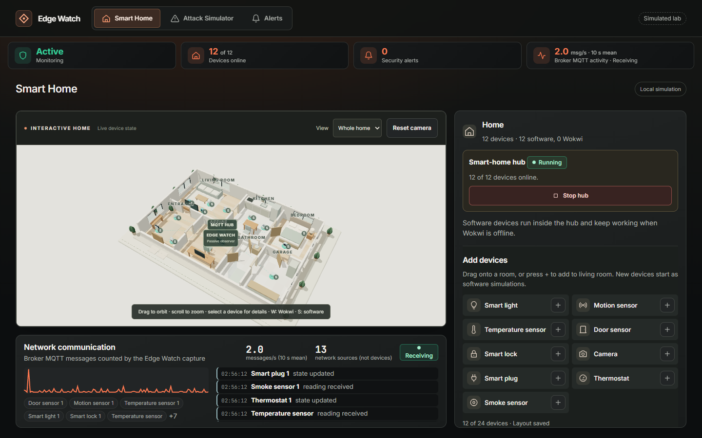
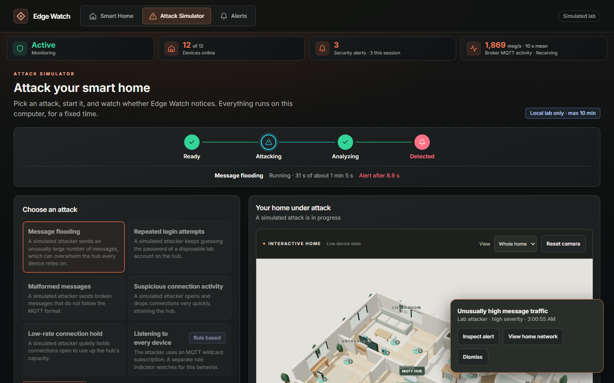
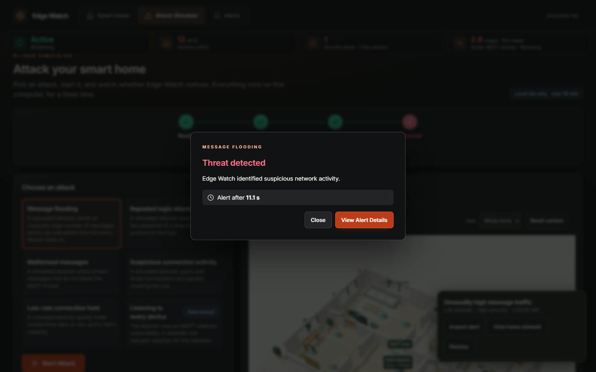
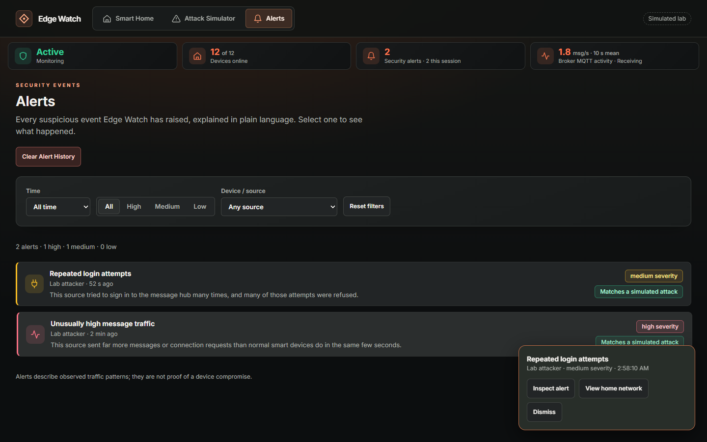
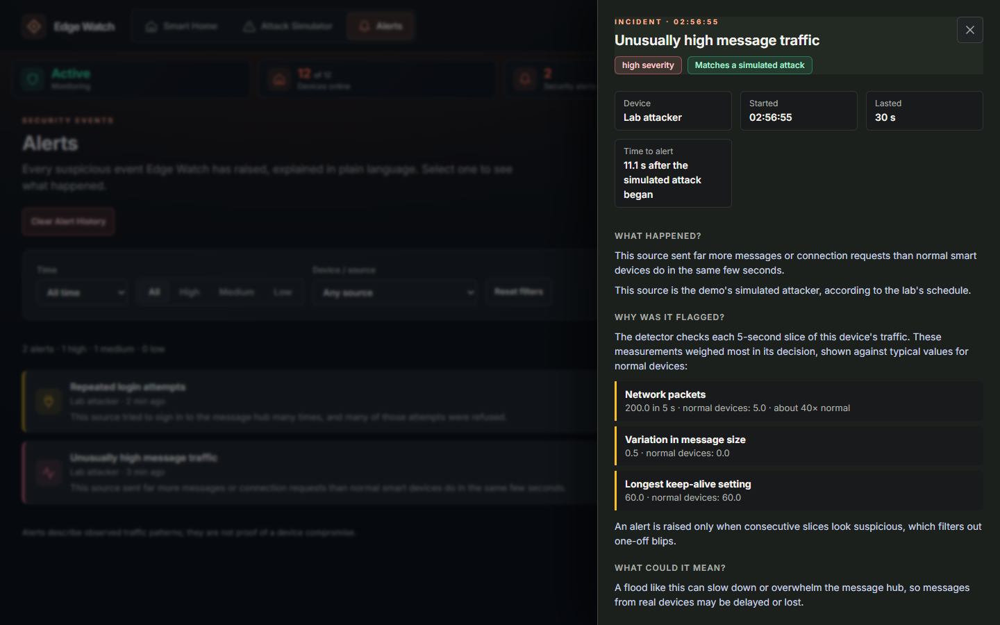
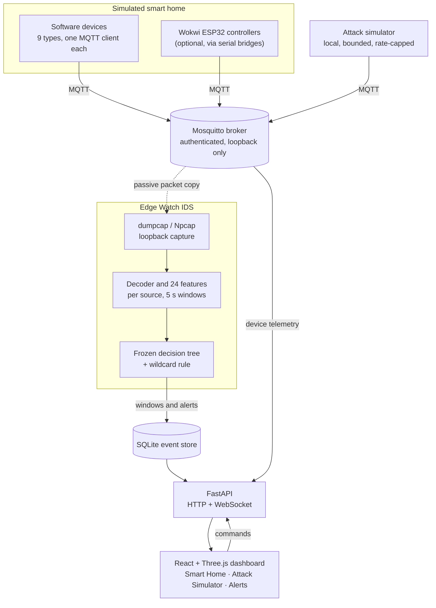
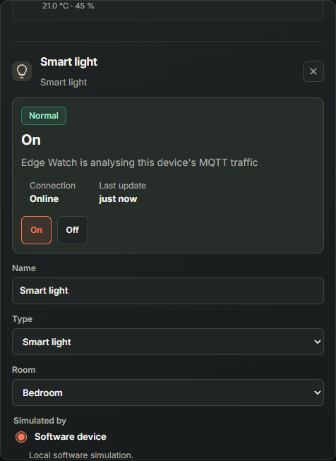

<div align="center">

# Edge Watch

**A passive intrusion detection system for MQTT smart homes, as an interactive, software-only lab.**

Build a virtual 3D smart home, control its devices over MQTT, launch bounded local attacks
against it, and watch a machine-learning IDS raise explained alerts in real time.




<sub>Smart Home page: 12 of 12 software devices online, live broker activity and the device feed.</sub>

</div>

---

<details>
<summary><b>Contents</b></summary>

[Overview](#overview) ·
[Preview](#preview) ·
[Architecture](#architecture) ·
[Features](#key-features) ·
[Smart home](#smart-home-simulation) ·
[Detection](#intrusion-detection) ·
[Tech stack](#technology-stack) ·
[Getting started](#getting-started) ·
[Demo walkthrough](#demo-walkthrough) ·
[Structure](#repository-structure) ·
[Status](#project-status)

</details>

## Overview

Smart-home devices commonly talk through a single **MQTT broker**. If that broker is flooded,
probed or brute-forced, every light, lock and sensor that depends on it is affected, and the
small devices themselves rarely have room for security software.

Edge Watch watches the broker's traffic from the outside instead:

| | |
|---|---|
| 👀 **Passive** | Captures MQTT packets on the loopback interface. It never sits in the message path, so it observes and alerts; it does not block traffic. |
| 🧠 **Learned + rule-based** | A frozen decision-tree model scores five-second, per-source traffic windows; a separate rule flags wildcard harvesting. |
| 🗣️ **Explained** | Each alert says what happened, which measurements drove it, and how they compare with normal devices. |
| 🧪 **Testable** | A built-in attack simulator runs local, rate-capped attacks so you can see detection, or a missed detection, for yourself. |

Everything runs on one Windows computer. No physical hardware, cloud service or internet
exposure is involved.

## Preview

All screenshots are from the running application (captured 2026-11-11 from a local run with
software-backed devices). Nothing is mocked up.

<table>
<tr>
<td width="50%"></td>
<td width="50%"></td>
</tr>
<tr>
<td><sub><b>Attack Simulator</b>: a message flood in progress. The flow reached <i>Detected</i> 8.9 s into the attack, and the alert notification appears live.</sub></td>
<td><sub><b>Run result</b>: reported only from real IDS events. Runs can also end as <i>missed</i>, <i>stopped</i> or <i>failed</i>.</sub></td>
</tr>
<tr>
<td></td>
<td></td>
</tr>
<tr>
<td><sub><b>Alerts</b>: severity, source, plain-language summary and whether the alert matches a scheduled simulated attack.</sub></td>
<td><sub><b>Incident detail</b>: time to alert, plus the measurements that weighed most against typical values for normal devices.</sub></td>
</tr>
</table>

## Architecture



The IDS only reads a copy of the traffic. Device readings reach the dashboard through a
separate telemetry observer, so the house works even when the IDS is stopped.
Details: [docs/ARCHITECTURE.md](docs/ARCHITECTURE.md).

## Key features

| Area | What you get |
|---|---|
| 🏠 **Smart Home** | Seven-room 3D cutaway house, drag-and-drop placement, saved layouts (up to 24 devices), camera orbit/zoom/room focus, and a keyboard-accessible device list and inspector. |
| 📡 **Network view** | Measured broker MQTT rate (10 s mean), active network sources and a live device event feed. Missing data stays shown as unavailable. |
| ⚔️ **Attack Simulator** | Six selectable attack scenarios, configurable duration, intensity and repeats, a live progress flow and honest outcomes. |
| 🚨 **Alerts** | Severity and time filters, per-source filtering, explained incident details and alert history clearing that asks for consent first. |
| ✅ **Honest UI** | Commands complete only on device acknowledgement. Smoke alarms (device safety) stay separate from IDS alerts. Simulated values are labelled as simulated. |

## Smart-home simulation

<table>
<tr>
<td width="62%">

Every device is an **independent MQTT client** with its own loopback address
(`127.0.4.x`), so the IDS sees realistic per-device traffic.

| Device | Interactions |
|---|---|
| 💡 Smart light | On / off |
| 🔌 Smart plug | On / off, modelled power use |
| 🌡️ Temperature sensor | Set room temperature and humidity |
| 🎛️ Thermostat | Raise / lower target, simulated heating |
| 🚶 Motion sensor | Trigger motion, auto-clear timer |
| 🚪 Door sensor | Open / close |
| 🔒 Smart lock | Lock / unlock, simulated keypad codes |
| 📷 Camera | Status and simulated events (no video) |
| 🔥 Smoke sensor | Simulated smoke alarm (device safety) |

Devices can instead be backed by four optional **Wokwi ESP32** firmware projects
(environment, access, lighting, safety) through serial-to-MQTT bridges.

</td>
<td width="38%">

<p><sub><b>Device inspector</b>: the light reports <i>On</i> after the device acknowledged the command.</sub></p>
</td>
</tr>
</table>

## Intrusion detection

**How it decides.** The IDS captures broker traffic, groups it into five-second windows per
network source and extracts 24 features (packet counts, connection churn, message sizes,
keep-alive values, refused logins and more). A frozen depth-12 decision tree
(`ew-dt12-lab-v6`) classifies each window. An alert is raised only when **consecutive**
windows look suspicious, which filters out one-off blips.

| ID | Simulator scenario | Detection |
|---|---|---|
| T1 | Suspicious connection activity (connect flood / churn) | Model (`flood`) |
| T2 | Message flooding (publish flood) | Model (`flood`) |
| T3 | Low-rate connection hold (SlowITe-style) | Model (`lowrate`) |
| T4 | Malformed messages | Model (`malformed`) |
| T5 | Repeated login attempts (password guessing) | Model (`bruteforce`) |
| T6 | Listening to every device (wildcard subscribe) | Low-severity **rule** indicator (no training data) |

The attack lab also contains a T7 topic-probing client, which has no dedicated detector.
Detection is not guaranteed, and recorded runs include missed detections.

**In the dashboard**, a new alert shows up as a live notification, in the header counter, on
the attacker's marker in the 3D house, and on the Alerts page, where the incident drawer
explains the evidence. The Attack Simulator reports *Detected* only when an IDS alert from the
scheduled attack source actually arrives. It waits ten seconds after the traffic ends before
reporting a miss.

**Safety limits** (enforced by [`lab/safety.py`](lab/safety.py)): loopback targets only,
600-second maximum per run, rate caps and a disposable lab account for password guessing.

## Technology stack

| Layer | Technology | Role |
|---|---|---|
| Messaging |  | Authenticated, loopback-only MQTT broker with ACLs |
| Capture |  | Npcap loopback packet capture, filtered to the broker port |
| Detection |   | MQTT decoder, feature extraction and frozen decision-tree inference |
| Storage |  | WAL event store for windows, alerts, topology and markers |
| API |  | REST + WebSocket stream, local-only controls, simulation manager |
| Frontend |     | Three-page dashboard with a React Three Fiber 3D house |
| Virtual firmware |   | Optional ESP32 projects run in Wokwi for VS Code |

## Getting started

**Prerequisites:** Windows, Python 3.11+, Node.js/npm, Mosquitto, and Wireshark with Npcap
(loopback capture). Wokwi + PlatformIO in VS Code are optional. See [Setup](docs/SETUP.md)
for exact versions and lookup paths.

> [!IMPORTANT]
> The trained demo needs the frozen **`ew-dt12-lab-v6`** model bundle at
> `$HOME\edgewatch-data\models\ew-dt12-lab-v6`. It is supplied separately; there is no public
> download. Without it, a clone still supports source inspection and the tests, but the IDS
> will not start. Do not retrain to replace it.

From the repository root in PowerShell:

```powershell
# 1. Python environment (pinned to the model's constraints)
python -m venv .venv
.venv\Scripts\python.exe -m pip install -e ".[offline,dev,wokwi]" -c constraints-model.txt

# 2. Build the dashboard
Push-Location dashboard/web
npm ci
npm run build
Pop-Location

# 3. Start the IDS, broker, devices, API and bridges (no attack starts automatically)
.\scripts\start-smart-home.ps1
```

Open **<http://127.0.0.1:8020>**. The broker listens on `127.0.0.1:18840`.

```powershell
.venv\Scripts\python.exe -m lab.startup status   # what is running
.venv\Scripts\python.exe -m lab.startup stop     # stop only what the launcher started
```

Problems? See [Troubleshooting](docs/TROUBLESHOOTING.md).

## Demo walkthrough

1. **Normal operation:** open **Smart Home**, choose *Start hub* if it is stopped, then add
   devices or start from a sample home. Select a device and toggle it; its state changes
   once the device acknowledges the command. Watch the network feed.
2. **Simulate an attack:** open **Attack Simulator**, pick a scenario such as *Message
   flooding*, choose **Start Attack**, adjust duration and intensity, then **Launch
   Simulation**.
3. **Observe detection:** follow the progress flow (Ready, Attacking, Analyzing, Result),
   the live alert notification and the attacker marker in the 3D house.
4. **Investigate:** open **Alerts**, filter by severity or source, and select an alert to
   see what happened, why it was flagged and what it could mean.

Full guide: [docs/USER_GUIDE.md](docs/USER_GUIDE.md).

## Repository structure

```text
EdgeWatch/
├── src/ids/            # IDS: capture, MQTT decoder, features, detector, alerts, SQLite store
├── dashboard/
│   ├── api/            # FastAPI app, simulation manager, alert history
│   └── web/src/        # React UI: smarthome, home3d, demo (attacks), alerts
├── lab/                # software devices, home broker, bridges, startup, attack lab, safety caps
├── simulators/         # Wokwi ESP32 firmware: environment, access, lighting, safety (+ legacy board)
├── scripts/            # Windows PowerShell launchers
├── tests/              # Python unit and integration tests
└── docs/               # guides, architecture, preserved technical references, assets/
```

Documentation index: [docs/README.md](docs/README.md) · Contributor rules:
[AGENTS.md](AGENTS.md) · Maintenance context: [CODEX_HANDOFF.md](CODEX_HANDOFF.md)

## Project status

Edge Watch is a **complete college demonstration project**, not a production security
product.

- ✅ Implemented: the three-page dashboard, nine software device types, four optional Wokwi
  controller projects, a passive live IDS with a frozen model, six detectable attack
  scenarios and an explained alert workflow.
- ⚠️ Limits: it runs on one computer over loopback only. It observes and alerts but does not
  prevent attacks, and detection is not guaranteed. Device readings, power use and camera
  events are simulated. There is no physical deployment or real-world validation.
- 📦 Not included: models, datasets, captures, databases and runtime credentials. Runtime
  files live outside the checkout in `$HOME\edgewatch-data`. The `deploy/` Linux examples
  are historical and unverified.

## Verification

```powershell
.venv\Scripts\python.exe -m pytest -q -m "not integration"
Push-Location dashboard/web
npm test
npm run build
Pop-Location
.venv\Scripts\python.exe -m pytest -q
```

The build includes TypeScript checks. Integration tests need local broker and capture tools
and use isolated ports. Never run `lab/e2e_cc.py` against a running user stack, and always
pass `--out` to a scratch folder when running `lab.e2e`.
