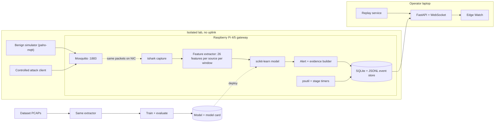

# Project Handover for an AI Assistant

**Project:** *How Lightweight Is Lightweight? End-to-End, Leakage-Controlled Evaluation of MQTT Intrusion Detection on an Edge Gateway* (demo product: **Edge Watch**).
**Prepared:** 2026-10-31, from all 44 documents in `docs/`, baseline v0.1 (2026-10-20), commit `bd8c85d`. Findings `F-xx` are explained in `docs/DOCUMENTATION_AUDIT.md`, and the important ones are repeated here. **Updated the same day with measured D-01 evidence (§2, §8, §18).**

## How to use this document

You are helping six university students continue this project. This document is self-contained. It reconstructs an existing plan, so **do not treat it as an invitation to redesign the project**. Read §20 before giving advice.

| Label | Meaning |
|---|---|
| **VERIFIED** | Checked directly in the repository on 2026-10-31, or recorded in the documents as read from a full-text source |
| **PROPOSED** | A design choice in the documents, awaiting team approval at M1 |
| **PROVISIONAL** | Usable working assumption, expected to change after review |
| **REJECTED** | Considered and rejected, with a reason |
| **UNRESOLVED** | An open question or missing rule |
| **UNKNOWN** | Information not in the documents. Ask; do not guess |

Literature evidence tags: **[R]** reported by the authors · **[I]** the team's interpretation · **[U]** unverified, from a secondary source or metadata.

**There are no model or experiment results.** Every number below is from the literature, a design target, a proposal, or a placeholder, except the D-01 data inspection figures in §8, which are measured from dataset files.

## 1. Project identity and objective

- **Recommended title (PROPOSED, DEC-05 pending):** as above. Plain alternative: *End-to-End Evaluation of Lightweight MQTT Intrusion Detection on a Resource-Constrained Edge Gateway*.
- **Team:** six students, roles S1–S6. Names and skills are UNKNOWN (Q-01). Supervisor: name UNKNOWN.
- **Goal:** produce credible, reproducible measurements of how well, and at what cost, lightweight MQTT intrusion detection works on a gateway-class device, and present them through a live, honest demonstration.
- **Contribution type (PROPOSED, ADR-01):** an evaluation and systems-measurement study. It is **not** a new model. Building a lightweight classifier is a means, not the contribution.

**Charter success criteria:**
1. RQ1–RQ3 answered with pre-registered experiments and CIs, whatever the outcome.
2. Every reported number traces to a `results/` file.
3. The demo repeats in live mode, with a working replay fallback.
4. A member who did not run them reproduces one offline and one edge experiment.
5. Every reference is verified, with its access level recorded.

| In scope | Out of scope |
|---|---|
| Plaintext MQTT 3.1.1 broker-targeted attacks T1–T5 (T6 as a rule) | Mitigation or blocking |
| MQTTset, MQTT-IoT-IDS2020, CICIoMT2024 | New deep-learning architectures |
| Isolated lab, simulated clients, scripted attacks | Public brokers, third-party devices, external networks |
| Raspberry Pi 4/5 gateway measurement | Cloud; microcontroller (TinyML) deployment |
| Edge Watch (live and replay) | Production SOC features |
| TLS feature ablation (optional E8) | MQTT 5-specific attacks; MitM detection |

**Constraints:** budget is one Raspberry Pi with power, cooling, and SD card, plus one small switch; other hardware is students' laptops. Attack generation only in the isolated lab. Datasets are never redistributed.

## 2. Current project status

| Item | Status |
|---|---|
| Research and design documents | Baseline v0.1, **pending team approval** (DEC-01) |
| Implementation, experiments, model training | Only the shared feature extractor core exists (`src/ids/features.py`, with synthetic tests; not yet run on real traffic). **No capture, models, lab, dashboard, or experiments** |
| Dataset files | All 6 MQTTset PCAPs and 3 reference files are on the coordinating laptop, outside Git and OneDrive. No other dataset is downloaded |
| Tools | `tshark`, `mosquitto`, `docker` not on PATH (VERIFIED). Setup guide not executed |
| Git | Branch `docs/phase-00-baseline`, with commit `4be5493` (handover, audit, `.gitignore`) and later uncommitted documentation edits; no remote. Older documents still say "not a Git repository" (outdated) |
| D-01 | **Open.** Raw-PCAP availability measured; dataset suitability inconclusive (§8). Option B proposed, **not approved** |
| Current gate | M0 not recorded as complete; M1 is the next major gate |
| All 12 ADRs | PROPOSED |
| Deadlines | UNKNOWN (Q-05). Never invent dates |

## 3. Research background

**The problem.** MQTT is a publish/subscribe protocol over TCP (ports 1883 plaintext, 8883 TLS). Clients CONNECT to a broker, PUBLISH to topics, and SUBSCRIBE to filters. The broker is the hub of the system, so its availability and access control matter, and authentication is a broker option rather than a protocol requirement [I; to be checked against the specifications].

**Why intrusion detection matters here.** Demonstrated attacks include CONNECT and PUBLISH floods, low-rate DoS (SlowITe), malformed packets, credential brute force, and wildcard topic harvesting. An edge gateway hosting the broker is a natural observation point. All MQTT-specific attacks in the public datasets target the broker [I].

**The exact problem being solved.** Published detectors report about 99% accuracy and sub-millisecond latency, so the problem can look solved. A practitioner still cannot answer two questions from the literature:
1. Will a lightweight detector still detect these attacks when evaluated without leakage, and how often will it raise false alarms on my benign traffic?
2. Can my gateway afford the **whole pipeline** at my message rate?

### Six quantities that must never be conflated

| Quantity | Meaning | Literature | Project measurement |
|---|---|---|---|
| **Model inference time** | Classifier call only | Commonly reported (P19 0.0725 ms/flow, hardware unspecified [R]; P27 0.19 ms on RPi 4, apparently model-only [R, verify]) | `inference`, batch size 1 (E3) |
| **Feature extraction time** | Turning packets into feature vectors | Rarely reported. P19 measured it offline: 2,925 flows in 7.76 s [R], about 2.65 ms/flow and about 37× its model latency [I; S1 must re-derive from the journal version] | `capture_to_parse`, `window_close_to_features` (E3) |
| **Full capture-to-alert latency** | Everything from packet to alert | Not found for MQTT multi-attack on a gateway [I; round-2 must confirm] | `processing_total`, `end_to_end` (E3) |
| **Gateway CPU and memory** | Device cost for IDS and broker | P24: ~54 MB, ~47% CPU on an RPi 3, not MQTT-specific [U] | psutil 1 Hz, vs. a no-IDS baseline (E4) |
| **Detection performance** | Quality under a named split | ~99% under random splits | Macro-F1, per-class recall, FPR with CIs (E1, E2) |
| **False alarms on independent benign traffic** | Behaviour on benign traffic the model did not train on | Not reported in reviewed MQTT papers [I] | FPR per window, false alerts per hour (E5) |

## 4. Literature findings

**Round 1 only.** Search date 2026-10-20, by an AI assistant, for team review. Sources: Crossref, Semantic Scholar, web search, PMC, arXiv, YorkSpace, official dataset pages. **IEEE Xplore, ACM DL, Scopus, and Web of Science were not searched directly.** 36 sources are catalogued.

**VERIFIED access counts:** 5 at full-text level (P08, P09, P19 thesis only, and dataset pages only for P20, P22). 31 are abstract or metadata level. The gap analysis says "8 read in full", which cannot be traced (F-14). **Use 5 unless the team can identify the other three.**

**What research has achieved:**
- **Near-ceiling accuracy.** RF 99.98% uni-flow on MQTT-IoT-IDS2020 [R, P09]; DNN 99.92% [R, P10]; ECSSA + LightGBM 98–99% [U, P13]; TabNet >99% on brute force [R, P19]. [I] When dissimilar models all reach about 99%, the benchmark is probably not separating them.
- **Flow beats packet features.** RF 65.39% at packet level vs. 99.98% uni-flow on MQTT-IoT-IDS2020 [R, P09].
- **Attacks and datasets exist.** Public datasets contain broker-targeted attacks (P08, P09, P15, P18, P22).
- **Gateway IDS is established.** Passban on RPi 3 [U, P24]; Kitsune [U, P23]; TCN on RPi 4, 4.22 W, 99.95% on an MQTT-based DDoS set [R, P27]. **Do not claim a first edge IDS.**
- **Light models are cheap.** Decision Tree best on training, inference, and power in one comparison [R, P25]; CPU beats Edge TPU for small models [R, P26].
- **Explanation exists.** XMID-MQTT [U, P17]; TabNet attention [R, P19]. **Not a novel contribution here.**

**Limitations of existing approaches [I, based on the sources above]:**
- **Split design.** P08 random 70/30 after replicating attack records, so copies can appear in train and test. P19 stratified random 80/20 after downsampling. P09 5-fold CV, with an inconsistent 75/25 description. No reviewed MQTT paper reports time-blocked or session-grouped splits.
- **Partial timing.** Model-only latency on unspecified hardware (P19), or DDoS only (P27).
- **Single environment.** Benign traffic comes from one simulated environment per dataset.
- **General evidence that this matters.** Pitfalls are widespread in top security papers [R, P30]. No model generalised across four NIDS datasets, and generalisation was asymmetric [R, P33]. Construction errors altered over 20% of CICIDS2017 traces [R, P31]. Proprietary features block cross-dataset comparison [R, P32]. False positives are expensive in an open world [P29].

**Closest work (must be cited fairly):**

| Paper | What it does | What this project adds | Do not claim as novel |
|---|---|---|---|
| **P19 MQTTFlowLyzer + TabNet** (thesis read; **journal not read**) | 404 features, ClientID + topic sessions, zero-day flagging, interpretation; names real-time deployment as future work | Compact live-computable features; controlled and cross-dataset splits; stage-wise cost on gateway; benign-lab FPR | MQTT-aware flow features, interpretability, zero-day flagging |
| **P27 TCN on RPi 4** (abstract) | DDoS; quantised TFLite; latency and power | Multiple MQTT attack classes; includes feature extraction; classical baselines | First RPi measurement |
| **P24 Passban** (abstract + secondary) | Anomaly IDS on RPi 3; CPU, RAM | MQTT-specific attacks and features; controlled evaluation | First gateway IDS |

### Sources (ID, access, full-text reviewer)

Access: FT full text · AB abstract · SEC some figures second-hand · MD metadata only. **Do not cite results from MD papers. The project also requires FT before any result is quoted in the final report.** Reviewer "—" means optional or not assigned.

| ID | Source | DOI / URL | Access | Reviewer |
|---|---|---|---|---|
| S1 | OASIS MQTT 3.1.1 (2014) | docs.oasis-open.org/mqtt/mqtt/v3.1.1/mqtt-v3.1.1.html | To read | S4 |
| S2 | OASIS MQTT 5.0 (2019) | docs.oasis-open.org/mqtt/mqtt/v5.0/mqtt-v5.0.html | To read | S4 |
| P01 | Firdous et al., MQTT attacks, 2017 | 10.1109/iThings-GreenCom-CPSCom-SmartData.2017.115 | MD | S4 |
| P02 | Andy et al., attack scenarios, 2017 | 10.1109/EECSI.2017.8239179 | MD | — |
| P03 | Hintaw et al., vulnerabilities survey, 2023 | 10.1080/03772063.2021.1912651 | MD | S4 |
| P04 | Vaccari et al., SlowITe, 2020 | 10.3390/s20102932 | AB | — |
| P05 | Casteur et al., fuzzing, 2020 | 10.1109/IWCMC48107.2020.9148320 | MD | S4 |
| P06 | Husnain et al., parsing-engine IDS, 2022 | 10.3390/s22020567 | AB | S5 |
| P07 | Alaiz-Moreton et al., multiclass, 2019 | 10.1155/2019/6516253 | AB | — |
| P08 | Vaccari et al., MQTTset, 2020 | 10.3390/s20226578 | FT | done |
| P09 | Hindy et al., MQTT-IoT-IDS2020, 2021 | 10.1007/978-3-030-64758-2_6 | FT | done |
| P10 | Khan et al., DNN, 2021 | 10.3390/s21217016 | AB | — |
| P11 | Mosaiyebzadeh et al., DL NIDS, 2021 | 10.1109/LATINCOM53176.2021.9647850 | AB | — |
| P12 | Liu et al., Bayesian rule learning, 2021 | 10.1145/3465481.3470046 | MD | S3 |
| P13 | Prajisha & Vasudevan, ECSSA + LightGBM, 2022 | 10.1007/s10207-022-00611-9 | AB+SEC | S3 |
| P14 | Omotosho et al., IDS-MA, 2023 | 10.1109/COMPSAC57700.2023.00093 | MD+SEC | S1 |
| P15 | Alatram et al., DoS/DDoS-MQTT-IoT, 2023 | 10.1016/j.comnet.2023.109809 | MD+SEC | S2 |
| P16 | Hanif & Ilyas, ensemble, 2024 (peer review unclear) | 10.5121/ijaia.2024.15401 | AB | — |
| P17 | Zeghida et al., XMID-MQTT, 2025 | 10.1007/s10207-025-01036-w | MD+SEC | S1 |
| P18 | Aveleira-Mata et al., MQTT_UAD, 2025 | 10.1016/j.dib.2025.112167 | AB | S2 |
| P19 | KouhiRonaghi & Habibi Lashkari, MQTTFlowLyzer, 2026 (York University MA thesis, 2025, read) | 10.1007/s11227-026-08485-7 | FT thesis | S1 (journal) |
| P20 | Neto et al., CICIoT2023, 2023 | 10.3390/s23135941 | FT page | done |
| P21 | Ferrag et al., Edge-IIoTset, 2022 | 10.1109/ACCESS.2022.3165809 | AB+SEC | S2 |
| P22 | Dadkhah et al., CICIoMT2024, 2024 | 10.1016/j.iot.2024.101351 | FT page | done |
| P23 | Mirsky et al., Kitsune, 2018 | 10.14722/ndss.2018.23204 | MD | — (F-07) |
| P24 | Eskandari et al., Passban, 2020 | 10.1109/JIOT.2020.2970501 | AB+SEC | S6 |
| P25 | Tekin et al., on-device energy, 2023 | 10.1016/j.iot.2022.100670 | AB | S6 |
| P26 | Hosseininoorbin et al., Edge TPU, 2023 | 10.1016/j.jpdc.2023.05.001 | AB | — |
| P27 | Akhi et al., TCN on RPi 4, 2026 | 10.1109/OJCOMS.2025.3649498 | AB | S6 |
| P28 | Spadaccino & Cuomo, edge IDS survey, 2022 | 10.52953/WNVI5792 | MD | — |
| P29 | Sommer & Paxson, Closed World, 2010 | 10.1109/SP.2010.25 | MD | — |
| P30 | Arp et al., Dos and Don'ts, 2022 | usenix.org/conference/usenixsecurity22/presentation/arp | AB | S3 |
| P31 | Engelen et al., CICIDS2017, 2021 | 10.1109/SPW53761.2021.00009 | AB | — |
| P32 | Sarhan et al., NetFlow features, 2022 | 10.1007/s11036-021-01843-0 | AB | — |
| P33 | Layeghy & Portmann, cross-domain, 2023 | 10.1016/j.compeleceng.2023.108692 | AB | — |
| P34 | Neupane et al., X-IDS survey, 2022 | 10.1109/ACCESS.2022.3216617 | MD | S5 |
| P35 | Shiravi et al., vis survey, 2012 | 10.1109/TVCG.2011.144 | MD | S5 |
| P36 | Light, Mosquitto, 2017 | 10.21105/joss.00265 | MD | — |

**Excluded or deferred:** N-BaIoT, Bot-IoT, TON_IoT, CIC IoT 2022 (E4: not MQTT-focused); Ullah & Mahmoud 2021 (partial E1); CICIDS2017 paper (indirect); an IIETA review (E2/E5). Deferred for round 2: Memon et al. 2023, Sharma et al. 2022, and several 2025–2026 Raspberry Pi IDS papers.

## 5. Research gap

**Candidate verdicts (PROPOSED):**

| # | Candidate | Verdict | Reason |
|---|---|---|---|
| G1 | High computational overhead | **REJECTED as stated** | Light models already infer under 1 ms (P19, P27); cheapest on device (P25) |
| G2 | No realistic gateway evaluation | Narrowed | Gateway deployment exists. Stage-wise, end-to-end, multi-attack MQTT measurement is what is missing |
| G3 | Quality vs. latency trade-off | Analysis, not novelty | Standard Pareto; meaningful only with G2 and G4 |
| G4 | Weak generalisation | Accepted for MQTT | Shown for NIDS generally. P14's cross-dataset claim is unverified |
| G5 | Insufficient benign FPR evaluation | Accepted, narrow | No reviewed paper tests FPR on fresh benign traffic |
| G6 | No end-to-end evaluation | **Accepted: core** | P19 and P27 report partial cost |
| G7 | Alert visibility | **REJECTED as primary** | P17, P19 address it. Kept as RQ4 |

**Strongest defensible gap (PROPOSED, DEC-02):**

> Published MQTT intrusion detectors report near-perfect accuracy. That accuracy comes from within-dataset, random or stratified splits, and from model-only latency on unspecified hardware. No reviewed work measures, on gateway-class hardware, (i) detection quality under leakage-controlled and cross-dataset evaluation and (ii) the end-to-end, stage-wise cost of the full capture-to-alert pipeline, together with (iii) false-positive rates on independent benign MQTT traffic.

**Why it is meaningful:** it replaces two untested readiness assumptions with measurements a gateway operator can use. A negative result is still a finding.

**Why it is defensible:**
- It is a *combination* claim, explicitly limited to the reviewed literature as of the search date. **The documents disclaim publication-level originality.**
- It rejected the weak version (G1) and concedes what P19, P24, and P27 already do.
- It has a documented rollback: if pre-empted, narrow to cross-dataset or benign FPR alone.

**Novelty risks (UNRESOLVED; the team marks each cleared, narrowed, or accepted risk at M1):** unread P14, P17, P23, P27; P19's journal version may add edge deployment; IEEE and ACM not directly searched; evaluation work may be judged less novel. Blueprint confidence that the gap is open: **Medium**.

**Contribution statement (draft):** a leakage-controlled benchmark; a stage-wise cost profile on a gateway; a benign-traffic false-alarm assessment; an open, reproducible pipeline and a demo showing only measured or explicitly labelled data.

## 6. Research questions and hypotheses

**Main RQ:** *On a gateway-class edge device, what detection quality and end-to-end operational cost do lightweight classifiers achieve for MQTT attacks when evaluated with leakage-controlled splits and independent benign traffic?*

There are **three primary sub-questions plus one secondary, descriptive one (RQ4)**. All PROPOSED, pending DEC-02.

| ID | Question | Objective | Hypothesis | Experiments |
|---|---|---|---|---|
| RQ1 | How much does detection quality change between random, time-blocked, session-held-out, and cross-dataset splits? | O1: macro-F1, per-class recall, FPR with 95% CIs; ≥3 models, ≥3 split strategies, ≥2 datasets | **H1:** macro-F1 under leakage-controlled splits is lower than under random splits by more than Δ (proposed 0.05, DEC-03 pending) | E1, E2, E9 |
| RQ2 | What is the end-to-end, stage-wise latency, throughput, CPU, and memory of the full pipeline on the gateway? | O2: p50/p95/p99 per stage; sustainable msg/s before drops; mean/peak CPU; peak RSS; ≥4 load levels | **H2:** for tree models, capture + feature extraction takes >50% of end-to-end per-window processing time | E3, E4, E6 |
| RQ3 | What FPR does the detector produce on independent benign MQTT traffic? | O3: FPR per window and false alerts per hour; ≥5 benign lab scenarios not used in training | **H3:** FPR on lab benign traffic is higher than FPR on the dataset test split | E5 |
| RQ4 | Can per-alert evidence be generated within the latency budget? | O4: added latency of top-k contributions | None | E7 |

### What would support or reject each hypothesis

**The documents do not define complete decision rules (F-08, UNRESOLVED).** The rows below show what the documents imply; the "UNRESOLVED" column must be decided by the team before the freeze.

| H | Supported if | Rejected if | UNRESOLVED |
|---|---|---|---|
| H1 | S-rand minus S-time macro-F1 exceeds Δ. This is the pre-registered primary comparison; other comparisons are exploratory | Difference ≤ Δ. That would suggest these MQTT benchmarks are more robust than feared, and remains a valid finding | Value of Δ; per-model vs. all models; per-dataset; how CIs are used; CI method if each class has one episode (F-05) |
| H2 | Share >50% for tree models | Share ≤50%, meaning the model is not secondary in cost | The formula itself (F-03); which load levels; which tree models; clock definition (F-04) |
| H3 | Lab benign FPR exceeds dataset test-split FPR | Lab FPR ≤ test FPR | Margin or test; which model and training data (F-10); one scenario or all |

**What makes this work different:** it combines leakage-controlled and cross-dataset evaluation, stage-wise measurement on the gateway including feature extraction, across multiple MQTT attack classes, with benign-lab FPR, using one shared extractor, under pre-registration, and with a demo tied to the measurements. Each piece exists separately; the combination is the claim.

## 7. System architecture

All PROPOSED (ADRs pending DEC-04). Two jobs share one extractor: an **offline pipeline** answers RQ1, and a **live pipeline** answers RQ2–RQ4 and drives the demo.

### From MQTT packet to alert

1. **Traffic.** C1 (benign) or C2 (attack) sends MQTT to C3 Mosquitto. C2 writes its ground-truth schedule **before** its first packet. C14 sequences runs and emits `run_marker` events.
2. **Passive capture.** C4 `tshark -l -T fields` with BPF `tcp port 1883` observes packets on the gateway NIC and streams decoded fields, plus a rotating PCAP. It never touches the traffic.
3. **Windowing.** C5 groups packets by **source IP** into tumbling **W = 5 s** windows, plus broker-wide context. The IP is a grouping key, **never a model input**.
4. **Inference.** At window end, C6 classifies the 26-feature vector with one scikit-learn model. Batch size is 1.
5. **Alerting.** C7 opens an alert when `score ≥ τ` for **k = 2 consecutive windows** from one source. Repeats are suppressed for 60 s. It adds top-5 evidence and a status.
6. **Storage.** C9 stores events as JSONL and SQLite. C8 adds 1 Hz resource samples and per-stage timings.
7. **Display.** C10 pushes events by WebSocket to C11 Edge Watch. C12 can stream a recorded run instead, stamped `replay`.

### Components

| ID | Component | Recommended |
|---|---|---|
| C1 | Benign simulator | Python + paho-mqtt, scenario YAML |
| C2 | Attack client | Scripted clients with target allow-list and rate caps |
| C3 | Broker | Eclipse Mosquitto 2.x |
| C4 | Capture | tshark; scapy fallback |
| C5 | Feature extractor | Pure Python + stdlib; pandas only offline |
| C6 | Inference | scikit-learn, joblib, version check at load |
| C7 | Alert + evidence | Threshold + k rule; tree contributions or LR coefficient × value |
| C8 | Resource monitor | psutil, `time.perf_counter_ns` |
| C9 | Event store | SQLite + append-only JSONL |
| C10 | Dashboard API | FastAPI + uvicorn |
| C11 | UI | Vite + TypeScript, Cytoscape.js, uPlot |
| C12 | Replay service | Small Python script, original timing |
| C13 | Offline pipeline | Python + scikit-learn, YAML configs, seeds |
| C14 | Experiment runner | Python, gateway clock as reference |

### Why the design is this way

- **Passive, no blocking (ADR-02).** Inline blocking adds availability and safety risks outside the research question. An inline proxy adds data-plane latency and a single point of failure; a broker plugin couples to Mosquitto and cannot see TCP behaviour. Cost: it cannot stop attacks, and that is stated openly. Also, the IDS service can be disabled while the broker keeps running.
- **One extractor for training and live inference (ADR-03).** Otherwise a model is measured on features it never trained on (train/serve skew). A parity test demands identical rows from the offline and streaming paths.
- **Re-extract from raw PCAP (ADR-03).** Dataset CSVs have incompatible definitions, and cannot be computed live. MQTTset's combined CSV drops IPs and absolute times (per the inspected script and P08; CSV not opened), so windows cannot be built from it (F-55). P32 and P31 motivate common, re-derived features. Consequence: numbers are not directly comparable with papers, which is intentional. E1-a provides a sanity anchor.
- **Prevent session and temporal leakage.** Adjacent windows are near-duplicates and sessions share behaviour, so random splits place near-copies in train and test. That is the very inflation under study, so the evaluation must not commit it.
- **Plaintext primary (ADR-08).** Under TLS a passive observer loses all `mqtt.*` fields. Results apply to plaintext or TLS-terminating gateways, and this is stated in results.

**Deployment views:** Dev (laptop; **never for RQ2 numbers**). Measurement (broker + C4–C9 on the Pi; C1/C2 on a second machine; C10–C12 on a laptop). Fallback (limited VM/container, every result labelled `emulated-constraint`).

**Resource budget (design targets, **not results**):** IDS CPU ≤ 1 core at nominal benign load; RSS ≤ 256 MB; end-to-end alert latency ≤ W + 1 s (p95); model artefact ≤ 20 MB.

**Other ADRs:** ADR-07 isolated lab; ADR-09 mandatory server-set provenance; ADR-10 dashboard stack (Grafana, Node-RED, and React + D3 considered and not chosen); ADR-11 joblib + model card, with refusal on version or feature-order mismatch; ADR-12 own traffic scripts; dataset attack tools only after S4 review.

### Event contract (schema `1.0`, frozen at M1)

- **Envelope:** `event_id`, `event_type` (`window`, `alert`, `resource`, `topology`, `run_marker`), `ts`, `run_id`, `provenance` (`live`, `replay`, `synthetic`), `traffic_source` (`benign_sim`, `attack_sim`, `mixed`, `dataset:<name>`), `schema_version`.
- **window:** bounds, pseudonymised `source_key`, `features`, `prediction`, `score`, `model_id`, `ground_truth` (nullable), `stage_latency_ms`.
- **alert:** `alert_id`, `window_ids`, `source_key`, `predicted_class`, `severity`, top-5 `evidence` (`feature`, `value`, `baseline_p50`, `contribution`), `status` (`unverified_prediction`, `matches_scheduled_attack`, `no_scheduled_attack`).
- **resource (1 Hz):** IDS and broker CPU and RSS, pkts/s, msgs/s, `capture_drops_total`, SoC temperature.
- **topology, run_marker:** nodes and edges; run and attack schedule markers.

## 8. Dataset strategy

All PROPOSED; final selection is pending D-01 to D-04.

| Dataset | MQTT attacks | PCAP | Role in train / validate / test | Status |
|---|---|---|---|---|
| **MQTTset** (P08) | Flood, DoS (MQTT-malaria), SlowITe, malformed, brute force [R]. Simulated smart home, Mosquitto 1.6.2, one week, broker-side | **Present in all 6 files (measured); D-01 Open** | **Primary.** E1 train/val/test, S-cross both directions. E1-a anchor | Depends on D-01 |
| **MQTT-IoT-IDS2020** (P09) | MQTT brute force only (+ scans, SSH brute force, excluded) [R] | Yes [R] | **Secondary.** E1 train/val/test; brute-force cross test; D-01 fallback primary | PROPOSED |
| **CICIoMT2024** (P22) | Malformed; DoS/DDoS connect flood; DoS/DDoS publish flood [R]. Independent lineage | Yes [R] | **Cross-dataset target** for E2 (both directions). Not in the E1 design | Licence D-04; IP anonymisation unchecked (F-27) |
| **Isolated lab** | T1–T5 scripted; T6 rule only; benign scenarios | Yes, generated | E3, E4, E5, E7, demo; S-episode. **Never in RQ1 training.** A separate "lab-trained" condition is mentioned but has no experiment ID (F-10) | PROPOSED |

**Candidates:** DoS/DDoS-MQTT-IoT (P15, D-02), MQTT_UAD (P18, D-03), Edge-IIoTset (P21; benign-shift probe, generic attacks, no experiment).
**REJECTED:** CICIoT2023 (no MQTT indicator or attack in the official feature and attack lists [R]). BCCC-MQTT-IDS-2025 (aggregates P08 + P09 + P15, so not independent; only for an as-published comparison with P19).

**Selection criteria:** genuine MQTT and MQTT-protocol attacks; raw PCAP; labels mappable to windows; terms allowing academic use; independent lineage for cross tests.

**Harmonised labels:**

| Family | MQTTset | MQTT-IoT-IDS2020 | CICIoMT2024 | Lab |
|---|---|---|---|---|
| `benign` | Legitimate | Normal | Benign | benign_sim |
| `flood` | Flood, DoS | — | Connect + publish floods | T1, T2 |
| `malformed` | Malformed | — | Malformed data | T4 |
| `bruteforce` | Bruteforce | MQTT_BF | — | T5 |
| `lowrate` | SlowITe | — | — | T3 |
| excluded | — | Scan_A, Scan_sU, Sparta | Non-MQTT attacks | — |

**Cross-dataset overlap:** MQTTset ↔ CICIoMT2024 on benign, flood, malformed. MQTTset ↔ MQTT-IoT-IDS2020 on benign, bruteforce. `lowrate` is only within-dataset or lab transfer. Binary results are also reported.

### D-01, the critical blocker

**Question (DECISIONS.md):** does MQTTset include raw PCAPs with IPs and timestamps? **Status: open, UNRESOLVED. Owner S2.** The documents also tie to it whether MQTTset has multiple episodes per class.

**Why it is critical:** ADR-03 needs PCAPs for the common extractor. The combined CSV drops IPs and absolute times (per the inspected script and P08), so windows keyed by source cannot be built from it.

**Documented path if the answer is no:** contact the authors (CNR-IEIIT), or make MQTT-IoT-IDS2020 primary alongside CICIoMT2024, and record it in DECISIONS.md. The MQTTset CSV could still serve the E1-a anchor [I].

**Effect not spelled out in the documents (F-02, UNRESOLVED):**
- MQTT-IoT-IDS2020 has only `bruteforce`, which CICIoMT2024 lacks, so that pair overlaps **only on `benign`** at family level.
- `lowrate` loses its only public dataset.
- E1 on the fallback is close to a two-class problem.
- RQ1 would then need redesign, likely using D-02 or D-03. Those remain open, so this is not yet a tested plan.

**Timing conflict (F-01, UNRESOLVED):** one document expects it resolved by M1, another by M2, while the protocol frozen at M1 names MQTTset.

### D-01 evidence (2026-10-31; D-01 remains Open)

Details: `docs/DOCUMENTATION_AUDIT.md` §12. Reports, aggregates, and the meeting package (`team-review\`): `C:\Users\aksha_q43exq6\edgewatch-data\reports\`, outside Git, on the coordinating laptop only. **`tshark` was not used. No model was trained.**

**Measured from the files:**
- All 6 PCAPs parse completely and contain IP addresses and timestamps.
- Durations differ from P08 for all 5 attack captures. `slowite.pcap` lasts 0.697 s, not 10 minutes. `capture_1w.pcap` is a real week.
- Rows at W = 5 s: benign 655,535; `bruteforce` 442; `flood` 69; `malformed` 54; `lowrate` 1. S-time test rows: 131,095; 81; 9; 10; 0 (F-46).
- **F26 is 5 or 10 in all benign rows and 1 in all attack rows.** Each attack file has one client, and no file has attack and benign traffic together.
- `malformed.pcap` shows no framing errors or selected-rule violations (F-60).

**From the author files:**
- Labels are set per CSV file, so they are **author assignments, not verified ground truth** (F-54).
- PCAP-to-CSV conversion is undocumented (F-55).
- The inspected script retains `mqtt.msg` in the combined CSV, which affects E1-a (F-56). No CSV has been opened.
- The inspected scripts have limitations, but **it is not established that they produced the published results** (F-57).
- README and Kaggle disagree on the licence, so licence and redistribution rights are unresolved (F-58).

**Unverified hypotheses:** F26 or F25 changing a model's scores; other features separating captures at window level; live-gateway F26 values; the benign file being purely benign. **Do not state that published MQTTset scores are invalid or inflated.**

**Status:** raw-PCAP availability is measured; dataset suitability is **inconclusive**. Option B, the proposed response, is **not approved**.

**Data handling:** raw data stays out of Git in `data/raw/`, read-only, with SHA-256 in `data/MANIFEST.sha256` and sources in `data/SOURCES.md`. Never redistribute dataset files or lab PCAPs. Keep `data/` outside OneDrive sync (D-05, recommended). The current MQTTset copy is at `C:\Users\aksha_q43exq6\edgewatch-data\raw\mqttset\`; D-05 and the final layout are still open.

**Data quality (Q1–Q12, before any training, reports at `results/data_quality/<dataset>.md`):** provenance (checksums, source, licence); consistency (counts vs. papers within 1%, attacker IP, benign in attack captures, duplicates, timestamps, malformed frames); shortcuts (Q10 non-feature model above 0.9 macro-F1, Q11 single-feature depth-1 tree above 0.95, inspected manually; Q12 benign KS tests).

**Labelling:** a window gets an attack family only if its source is the attacker and it lies inside a documented interval. Attacker windows outside intervals are benign only if documented, otherwise dropped and counted. Straddling windows are `mixed` and excluded from test sets. Lab labels come from `schedule.json`, **never from model output**.

## 9. Feature extraction specification

**Version `fx-0.1` (draft).** Any change bumps the version and invalidates feature tables. **Unit:** tumbling window (default W = 5 s), per source IP of packets to the broker port, plus broker replies attributed to that source.

**Input fields (same live and offline; S4 must verify names against installed tshark):**
`frame.time_epoch ip.src ip.dst tcp.srcport tcp.dstport tcp.len tcp.flags.syn tcp.flags.ack tcp.flags.reset tcp.flags.fin mqtt.msgtype mqtt.len mqtt.qos mqtt.retain mqtt.kalive mqtt.conack.val mqtt.topic _ws.malformed`

| ID | Name | Definition | Attacks | TLS? |
|---|---|---|---|---|
| F01 | `pkts` | Packets to broker port | T1, T2 | Yes |
| F02 | `bytes` | Sum of `tcp.len` | T2 | Yes |
| F03 | `syn` | SYN without ACK | T1, T7 | Yes |
| F04 | `rst` | RST, both directions | T4, T7 | Yes |
| F05 | `fin` | FIN count | T1, T5 | Yes |
| F06 | `conn_distinct` | Distinct source ports | T1, T5 | Yes |
| F07 | `iat_mean` | Mean inter-arrival (W if <2 packets) | T3 | Yes |
| F08 | `iat_std` | Std inter-arrival | T2, T3 | Yes |
| F09 | `mqtt_connect` | CONNECT count | T1, T5 | No |
| F10 | `mqtt_connack_refused` | CONNACK with code ≠ 0 | T5 | No |
| F11 | `mqtt_refused_ratio` | F10 / max(F09, 1) | T5 | No |
| F12 | `mqtt_publish` | PUBLISH count | T2 | No |
| F13 | `mqtt_subscribe` | SUBSCRIBE count | T6 | No |
| F14 | `mqtt_pingreq` | PINGREQ count | T3 | No |
| F15 | `mqtt_disconnect` | DISCONNECT count | T1, T5 | No |
| F16 | `mqtt_len_mean` | Mean `mqtt.len` | T2, T4 | No |
| F17 | `mqtt_len_std` | Std `mqtt.len` | T2 | No |
| F18 | `mqtt_len_max` | Max `mqtt.len` | T2, T4 | No |
| F19 | `topics_distinct` | Distinct topics (count only) | T2, T6 | No |
| F20 | `qos_gt0_frac` | Fraction of PUBLISH with QoS > 0 | T2 | No |
| F21 | `retain_frac` | Fraction of PUBLISH with retain | T2 | No |
| F22 | `keepalive_max` | Max keep-alive in CONNECTs; carried across the connection | T3 | No |
| F23 | `malformed` | Packets flagged `_ws.malformed` | T4 | No |
| F24 | `wildcard_sub` | SUBSCRIBEs with `#` or `+` | T6 indicator | No |
| F25 | `ctx_broker_msgs` | All MQTT messages, all sources | DDoS context | Partial |
| F26 | `ctx_active_sources` | Distinct active sources | DDoS context | Yes |

**Rules:** windows align to `floor(t/W) × W`; offline uses PCAP time. A source with zero packets in a window produces **no row**. Non-MQTT TCP on 1883 counts toward F01–F08 only.

**Excluded, always:** IPs, ports, MACs (identity shortcuts); absolute timestamps and `tcp.stream`; client ID, username, password; topic strings and payload bytes (privacy, non-transferable); TTL, window size, checksums (testbed artefacts).

**Known concern (F-09, UNRESOLVED):** SlowITe holds connections quietly, and the no-row rule may make T3 invisible in many windows.

**Attack families:** T1 CONNECT flood, T2 PUBLISH flood, T3 low-rate DoS, T4 malformed, T5 brute force, T6 wildcard subscribe (rule only, no training data), T7 scans (optional). **A passive observer cannot:** distinguish successful brute force from legitimate login once credentials are correct; see payload abuse by authorised clients; see inside TLS beyond size and timing; detect misuse by a client with valid credentials and permitted topics.

## 10. ML methodology

| Model | Role | Grid (validation only) |
|---|---|---|
| Logistic Regression | Linear baseline; direct evidence | `C ∈ {0.1, 1, 10}`, standardised |
| Decision Tree | Cheapest candidate (P25) | `max_depth ∈ {4, 8, 12}` |
| Random Forest | Strong candidate (P08, P09) | `n_estimators ∈ {25, 50, 100}` × `max_depth ∈ {8, 16}` |
| HistGradientBoosting | Boosting, no new dependency | `max_iter ∈ {100, 200}` × `learning_rate ∈ {0.05, 0.1}` |
| Isolation Forest | Unsupervised reference (P33). **E2 only, binary only** | Not specified |

**REJECTED:** XGBoost/LightGBM (extra dependency; add only if a reviewer requests it); DNN/LSTM/CNN (well covered; no RQ needs them); TCN (P27 covers it); TabNet (P19; 404 features; optional offline comparison only); kNN and SVM-RBF (inference grows with training set); federated learning (P14, P21 cover it).

**Training order as documented:** PCAP → tshark export → extractor → label join + quality checks → splits → preprocessing fitted on TRAIN only → grid on VAL → refit on TRAIN+VAL → threshold on VAL → single TEST evaluation → `metrics.json`, `model_card.json`, joblib.

**Issue (F-06, UNRESOLVED):** choosing the threshold on VAL after refitting on TRAIN+VAL is optimistic.

**Rules:** a scikit-learn `Pipeline` prevents preprocessing leakage. Test is touched **once** per (model, split, seed); anything changed afterward is a new experiment ID. Seeds 0–4. One YAML config per experiment. Threshold target default ≤ 1% of benign windows (to be fixed at M1).

**Deployed model (UNRESOLVED until E6):** chosen on the Pareto front of leakage-controlled macro-F1 vs. gateway p95 latency, meeting the budget. A team decision. Its training data is undefined (F-10).

## 11. Evaluation and leakage prevention

| Split | Definition | Controls | Applies to |
|---|---|---|---|
| **S-rand** (reference) | Stratified random 70/15/15 over windows | None; reproduces common practice | All |
| **S-time** | Per capture: first 60% train, next 20% val, last 20% test, gap 2W | Temporal autocorrelation; adjacent near-duplicates | All |
| **S-episode** | Group 5-fold over attack episodes and equal benign blocks | Session/episode leakage | Lab; datasets with ≥3 episodes per class (MQTTset probably has 1) |
| **S-cross** | Train on all of A, test on B, harmonised families | Testbed artefacts, shortcuts | MQTTset ↔ CICIoMT2024; MQTTset ↔ MQTT-IoT-IDS2020 |

**Leakage controls:** no oversampling before splitting (MQTTset's balancing replicated records); imbalance handled inside the training fold only (class weights first, benign undersampling second); no feature selection using test data; identity and time fields excluded; same features and models across splits, so the split is the only E1 variable; quality checks Q10–Q12; E1-a anchor.

| Experiment | Question | Design | Owner | Status |
|---|---|---|---|---|
| E1-a | Sanity anchor | RF on published CSV, S-rand; vs. P08/P09 | S3 | planned |
| E1 | Effect of split | {LR, DT, RF, HistGB} × {S-rand, S-time, S-episode where possible} × 5 seeds, MQTTset and MQTT-IoT-IDS2020 | S3 | planned |
| E2 | Cross-dataset | + Isolation Forest (binary); A→B and B→A; binary and family; asymmetry | S3 | planned |
| PILOT-E3 | Set load levels | Find rate at which drops start | S4 | planned |
| E3 | Stage latency | {50, 200, 1000, 5000} msgs/s (adjusted by pilot), 10 min, 3 reps, per model; max rate with <0.1% drops | S4 + S6 | planned |
| E4 | Resources | During E3; no-IDS baseline; model size | S4 + S6 | planned |
| E5 | Benign FPR | ≥5 unseen scenarios: steady, bursty, QoS 1/2 heavy, retained churn, reconnect storm, new device; 30 min each | S6 | planned |
| E6 | Pareto | E1 S-time macro-F1 + E3/E4 | S3 | planned |
| E7 | Evidence cost | E3 at nominal rate, evidence on vs. off | S3 | planned |
| E8 | TLS-visible only (optional) | F01–F08, F26 under S-time | S3 | deferred; decide at M3 |
| E9 | Window size | W ∈ {1, 5, 10} s, best model, S-time, + E3 at nominal rate | S3 | planned |
| DQ-* | Data quality | Each dataset | S2 | planned |

**Metrics.** Primary: macro-F1 (S-time) and end-to-end p95 (E3). Secondary: per-class recall, FPR, false alerts per hour, time-to-detect, CPU %, RSS, PR-AUC, balanced accuracy, and alert precision. Plain accuracy only for comparing with prior papers, never as a headline.

**Uncertainty.** Mean ± std over seeds; 95% CI via episode-level bootstrap, 1,000 resamples; paired bootstrap for model comparison. **Issue (F-05):** this may be degenerate with one episode per class. Lab: E3 has 3 reps; E5 has 1 run per scenario, plus a second if FPR exceeds 1%. "A single run is never a result".

**Calibration.** Reliability diagram and Brier score. If ECE > 0.05, the UI says "model score", not "confidence".

**Alert severity.** `high`: flood or malformed with score ≥ 0.9, or a source alerting over 60 s. `medium`: other attack classes at score ≥ τ. `low`: rule indicators only.

**Evidence wording.** Evidence shows *what the model weighted*; it is not proof of an attack.

**Threats to validity (documented):** dataset label errors; our extractor vs. published features; one episode per class; window metrics vs. operator experience; score vs. probability; lab-only data; one gateway model; plaintext only; multiple comparisons (primary pre-registered, others exploratory).

## 12. Gateway deployment plan

**Hardware (PROPOSED, ADR-06):** Raspberry Pi 4 (4 GB) or Pi 5, Raspberry Pi OS Lite 64-bit; exact model UNRESOLVED (Q-02). Physical hardware is justified because the gateway is the object of measurement: ARM micro-architecture, real NIC and driver capture, thermal throttling, SD-card I/O. Fallback only if unavailable: limited VM/container labelled `emulated-constraint`. A laptop is development only.

**Measurement conditions (E3, recorded per run):** CPU governor `performance`; temperature logged and throttled runs flagged via `vcgencmd get_throttled`; heatsink/fan recorded; wired Ethernet, Wi-Fi off; no other user processes; load generated on a **separate** machine; 60 s warm-up discarded; report device, RAM, OS image and date, kernel, Python, scikit-learn, tshark, Mosquitto versions.

**Stage latency definitions:**

| Name | Definition |
|---|---|
| `capture_to_parse` | tshark decode time per packet (`frame.time_epoch` vs. Python receipt) |
| `window_close_to_features` | Window end to finished vector |
| `inference` | `t_inference_done − t_features_done` |
| `alert_build` | `t_alert_done − t_inference_done` |
| `processing_total` | `t_alert_done − window_end` (overhead beyond the window wait) |
| `end_to_end` | `t_alert_done − first packet in window` |

**Open measurement issues (UNRESOLVED):** H2 formula (F-03); `perf_counter_ns` vs. wall-clock (F-04); `dumpcap` may need sampling (F-12); W + 1 s budget vs. k = 2 delay (F-24).

**Service:** systemd `edgewatch-ids`. Must run 1 h at nominal rate with RSS slope ≈ 0. Rollback: disable the service; the broker is unaffected.

**Setup, not executed (SETUP_GUIDE):** WSL2 + Ubuntu 24.04 on Windows dev machines; Mosquitto bound to the lab interface, `allow_anonymous false`; versions pinned from a lock file. Laptop inventory (2026-10-20): Windows 11; `python` 3.13.7, while `pip` points to Anaconda 3.12 (use a venv); scikit-learn 1.8.0, pandas 2.3.3, numpy 2.3.3, psutil 5.9.0 in Anaconda; Node v26.8.1. Install approval is open (Q-08).

**Lab safety (non-negotiable):** isolated switch/AP with no uplink, or host-only network; attack scripts abort on a non-allow-listed target; rate and duration caps; lab-only credentials in a gitignored `.env`; no public brokers, including "test" ones; no scanning; no third-party devices; every run writes a manifest.

## 13. Edge Watch visualization

**Goal:** an impressive, futuristic, technically credible console, not a circuit, a terminal, or a static dashboard. **Principle:** the interface is a window onto a **measured** system. Every moving element is driven by an event. Nothing animates without data behind it. Every major element must trace to a finding or requirement, or it is removed. All PROPOSED.

**Within 5 seconds the audience should see:** what is connected; what is happening; what the gateway detects; how efficiently it runs; and whether this is live or replayed.

**Panel IDs.** The documents' IDs are canonical. `P1`–`P8` are panels; `P01`–`P36` are papers.

**Provenance applies to all event-driven panels (P1–P7).** Each event has a server-set `provenance` shown in the P1 badge as **`LIVE`, `REPLAY`, or `SYNTHETIC`**. The stored enum is lowercase. `SYNTHETIC` is for layout work only. P8 is the exception: it reads result files, and never uses placeholder data.

| Panel | Displays | Data origin | Data mode | Research link | What it demonstrates |
|---|---|---|---|---|---|
| **P2 Network topology** | Devices, broker, gateway, `attack_sim` only when traffic source says so; edges by rate; node state by shape and colour. Silent nodes hollow, never shown as attacks | `topology`, `window` | Live / replay / synthetic | Broker-targeted attacks, per-source windows | The observed system, and where suspicion is |
| **P3 Traffic timeline** | msgs/s, packets/s, **scheduled attack bands**, alert markers ◆ | `resource`, `run_marker`, `alert` | Live / replay / synthetic | RQ3; prediction vs. truth | Detections against recorded ground truth |
| **P4 Pipeline stages** | Packets → Features → Inference → Alert with rolling p50/p95 ms over 60 windows; windows/s; **share bar**; drops badge | `window.stage_latency_ms`, drops | Live / replay / synthetic | **RQ2, H2** | The central contribution: where time really goes |
| **P5 Detection feed** | Per-source prediction and score; alert queue; **status chip**. "No alerts in this run" is deliberately shown during benign phases | `window`, `alert` | Live / replay / synthetic | **RQ3**, RQ1 | False alarms as a result; prediction ≠ fact |
| **P6 Investigation drawer** | Top-5 features, value, benign median, contribution; 12-window sparklines; raw counts; ground-truth status; time-to-detect. Footer: "Evidence shows what the model weighted; it is not proof of malicious intent." | `alert.evidence`, window history | Live / replay / synthetic | RQ4 | Cheap, measured evidence, not novelty |
| **P7 Edge resources** | IDS and broker CPU %, IDS RSS, temperature, throttle flag, drops, rates | `resource` (1 Hz) | Live / replay / synthetic | **RQ2** (E4) | Real gateway cost, including throttling |
| **P8 Research results** | E1 bars with CIs; E2 heatmap; confusion matrix; E3/E4 stage bars and CPU/RSS; E5 false alerts; E6 Pareto. Each with experiment ID, run date, device. "Experiment not yet run" if no file | `/api/results` from `results/*/metrics.json` | **Measured results only; never synthetic** | **RQ1–RQ3** | The measurements behind the demo |
| **P1 Persistent status bar** | Run id; scenario; model id and training split; **provenance badge** ≥ 28 px (`LIVE` cyan, `REPLAY` magenta, `SYNTHETIC` grey); gateway clock; stream delay (amber > 2 s, red > 10 s). Mixed or missing provenance: red bar, "Provenance unknown – do not present" | Event envelope, `run_marker`, `/api/health` | Live / replay / synthetic | Honesty rule | What you are seeing, and how much to trust it |

**Honesty rules (must survive every redesign):**
- Server-assigned provenance on every event. The UI has **no toggle**. The replay service **cannot** emit `live` (unit test U8).
- **Predictions are never presented as confirmed attacks.** Statuses are `unverified prediction`, `matches scheduled attack`, or `no scheduled attack`. Forbidden words: "confirmed", "blocked", "neutralised".
- Column heading is "Score" unless calibration passes.
- Results shown only from result files. Placeholder numbers in sketches are for layout only.

**REJECTED ideas:** threat-level gauge (no defined metric); geographic attack map, global arcs, IP geolocation (the lab has no geography); packet-payload viewer (breaches privacy); "blocked attacks" counter (no mitigation); random numbers to look busy; idle radar sweeps and decorative scan lines; saturated neon on large areas (accents kept under about 10% of the screen).

**Design system:** dark theme. Tokens: `--bg #0A0E16`, `--surface #111827`, `--surface-2 #1A2233`, `--line #243047`, `--text #E6EAF2`, `--text-dim #93A0B8`, `--cyan #22D3EE`, `--blue #3B82F6`, `--violet #A78BFA`, `--amber #F59E0B`, `--red #F43F5E`, `--replay #E879F9`. Inter for UI; JetBrains Mono with tabular figures for numbers. State is never colour alone: benign ●, suspicious ▲, alert ◆, offline ○. Contrast ≥ 4.5:1; respects `prefers-reduced-motion`.

**Motion, each tied to an event:** edge particles (density ∝ log(rate)); amber node pulse on an attack prediction, 600 ms; alert ripple to gateway, 800 ms; pipeline stage flash, 150 ms.

**Patterns borrowed:** network service maps, SOC alert queues, mission-control telemetry, digital-twin zones, and P35's monitoring vs. investigation split.

**Technical requirements:** WebSocket `/ws/events`, REST `/api/results`, `/api/runs/<id>`, `/api/health`. Render ≤ 10 Hz; ≥ 50 sources and ≥ 20 window events/s. No external network calls at runtime: fonts and libraries are bundled. 1920×1080 primary; stacked below 1280 px. Keys: `R` research view, `Esc` closes drawer, arrows move between alerts.

**Demo (8–10 min, repeatable):**

| Scene | Action |
|---|---|
| 0 | Empty console |
| 1–2 | 12 simulated devices in 2 zones; benign steady state; "No alerts" framed as the RQ3 story |
| 3 | Runner records the schedule, then T5 brute force starts, chosen for a clear signal in F11 |
| 4 | Node pulses; alert after 2 windows; chip checks it against the schedule |
| 5 | P6 evidence opened |
| 6 | Attack ends |
| 7 | Optional T1 flood; stage time and CPU change |
| 8 | Press `R`: measured results in P8 |
| 9 | Limitations card |

**Fallbacks:** Live → Replay of a real recorded run → Video with a title card. The presenter states the mode aloud. If preflight checks 1–6 fail, switch to replay. Unexpected benign alerts are genuine false positives and are **not hidden**. Never retune on E5 data.

**Issues to fix before use (F-22, UNRESOLVED):** the script line "every particle is a real MQTT message" conflicts with log-scaled, capped particles. Scene 7's script asserts H2 before it has been measured. Say what was measured, once it has been.

## 14. Six-person team structure

Role-based and **PROVISIONAL**. Assign names at M0, and swap roles according to strengths. **Do not invent names or redistribute without recording the reason.**

| ID | Role | Responsibility | Deliverables | Assessed on |
|---|---|---|---|---|
| S1 | Research lead | Literature, gap validation, novelty, report §1–3 | Round-2 search; reviews; frozen gap; REFERENCES; final claim audit (with S6) | References, gap quality, no unsupported claims |
| S2 | Data lead | Datasets, licences, quality, labels | D-01–D-04; checksummed data; DQ reports; harmonisation; DATA_DICTIONARY | Reproducible data pipeline; documented discrepancies |
| S3 | ML lead | Splits, models, offline evaluation, calibration | `splits.py`, `train.py`, `evaluate.py`; E1-a, E1, E2, E9, E6, E7; model cards | Leakage controls; completeness; CIs |
| S4 | Lab & gateway lead | Lab, broker, generators, gateway service | Lab network; C1, C2, C14; Mosquitto config; `live.py`; PILOT-E3, E3, E4; allow-list | Lab safety; stability; documented conditions |
| S5 | Visualisation lead | Edge Watch, replay, design system | C10–C12; P1–P8; walk-through; screenshots with provenance | Spec compliance; honesty rules |
| S6 | Integration & QA lead | Extractor, testing, integration, E5, doc consistency, presentation coordination | `features.py` + tests (with S2); TESTING_STRATEGY; E5; rehearsals; demo archive; DECISIONS | Shared-core tests; integration; E5 |

**Why S6 owns the extractor:** it is the shared interface between S2, S3, and S4, so one person owns the parity test.

**Three-paper full-text assignment (18 total):**

| Student | Papers | Key question |
|---|---|---|
| S1 | **P19 journal**, **P14**, **P17** | Grouped or temporal splits, cross-dataset tests, or edge measurement that pre-empt RQ1–RQ2? |
| S2 | P15, P18, P21 | PCAP availability, labelling, independence, MQTT columns |
| S3 | P13, P12, P30 | Split strategies, baselines, pitfalls checklist |
| S4 | P01, P03, P05 | Attack mechanics T1–T6; safe reproduction; spec references |
| S5 | P34, P35, P06 | Explanation presentation; visualisation taxonomy; validation indicators for panel P6 |
| S6 | P24, P25, **P27** | How was resource cost measured: model-only or end-to-end? Tools? Device settings? |

**Priority reads (Phase 00):** P19 journal version, P14, P17, P27, **P23**. Each must answer "does it pre-empt RQ1–RQ3?" **P23 has no assigned reader (F-07, UNRESOLVED).** The review template is in LITERATURE_REVIEW Appendix A: problem; method; datasets and split strategy; attacks; metrics with table numbers; hardware (model-only or end-to-end? batch?); stated and substantiated limitations; pre-emption verdict; quotes with page.

**Shared responsibilities:**
- **Hand-offs:** S2→S6 PCAPs and labelling; S6→S2/S3/S4 `features.py` (versioned); S2→S3 `windows.parquet` + DQ report; S3→S4 model + card; S4→S5/S6 events; S3/S4/S6→S5 metrics; all→S1 claims.
- **Four-eyes reviews:** full-text reviews by next student (S1→S2 … S6→S1); extractor S2 + S4; splits and evaluation S6; attack scripts S1 + supervisor; dashboard wording S1; results tables by a re-running student.
- **Whole-team decisions:** gap and RQs; Δ; primary dataset; extractor freeze; deployed model; event schema changes; official demo run; safety boundaries; adding mitigation (default no).
- **Integration and QA:** S6. M0, M5 (with S5), and M6 gates also sit with S6.

**Speakers (provisional):** S1 problem to RQs; S2 + S3 architecture, data, models; S5 + S4 demo; S3 + S6 results; S6 limitations and Q&A.

## 15. M0–M6 roadmap

**No calendar dates exist. Do not invent them** (Q-05). **Critical path: M1 → Data (Phase 01) → Offline baselines (Phase 03) → Gateway measurement (Phase 04) → Integration (Phase 06).** Parallel after M1: lab (Phase 02) and dashboard on synthetic events (Phase 05a).

| | Objective | Tasks | Depends on | Deliverables | Acceptance | Blocking decisions | Gate |
|---|---|---|---|---|---|---|---|
| **M0** | Documents reviewed | All six read the blueprint; assign names; set dates | — | Named team; dates | Blueprint read; Q-01–Q-07 answered or assigned | Q-01, Q-05, DEC-01 | S6 |
| **M1** | Research validated, protocol frozen (Phase 00) | 18 reviews; priority reads; round-2 search; re-run gap table; fix Δ and threshold target; freeze protocol; Git | M0 | `reviews/*.md`; updated matrix; gap v1.0; frozen protocol | See checklist below | DEC-02, 03, 04, 05; D-01 (F-01); Q-02, 03, 04 | S1 |
| **M2** | Data + lab ready (Phases 01, 02) | Download, checksum; resolve D-01; verify tshark fields; build `fields.py`, `features.py`, labels; Q1–Q12. Isolated network, broker, simulator, attack scripts, runner, E5 scenarios, tool review | M1, hardware, terms | `data/raw` + checksums; `windows.parquet`; DQ reports; `fx-0.1`; lab scripts; archived run | Checksummed; DQ reviewed by S2 + S3; extractor and parity tests pass; lab run (benign 5 min → T5 2 min → benign 3 min) archived; no packets leave | D-01–D-05, Q-02, Q-03, Q-04, Q-08 | S2 + S4 |
| **M3** | RQ1 results (Phase 03) | `splits.py`, `train.py`, `evaluate.py`; E1-a, E1, E2, E9; calibration | M2, frozen protocol | Metrics, confusion matrices, cards, plots | Completed or deferred with reasons; CIs; second student reproduces within ±0.01 macro-F1; candidates chosen | Primary dataset; E8 decision; Q-06 | S3 |
| **M4** | RQ2 results (Phase 04) | Live runner; timers; loader; systemd; PILOT-E3; E3, E4, E7; E6 | M2, M3, gateway | Service; `stage_latency.csv`, `resource.csv`, `capture_stats.json`; results | 1 h stable; E3, E4, E7 done; budget result recorded honestly; model via E6 | Deployed model; Q-07 | S4 |
| **M5** | Integrated demo + RQ3 (Phases 05, 06) | Backend, panels, replay, walk-through; live stream; E5; 3 rehearsals; official demo run | M1 (contract), M4; Phase 05 replay | Console; E5 results; demo archive; rehearsal log | Live and replay work; all empty and error states; offline at 1280×720 and 1920×1080; walk-through passes; I1–I5; E5 recorded | Official demo run | S5 + S6 |
| **M6** | Report + presentation (Phase 07) | Reproducibility check; claim audit; reference audit; report; limitations; 2 dress rehearsals | M5 | Report; slides; `CLAIM_AUDIT.md`; reproducibility log | 0 untraced numbers; all DOIs resolve; quoted results at FT; Definition of Done met | — | S6 |

**Dashboard build order:** P1 → P5 → P2 → P4 → P3 → P7 → P6, then P8 last, once results exist. Synthetic generator → backend → replay → live. Timeboxed so visuals do not displace research (R11).

**Draft consolidated M1 checklist (PROPOSED; assembled from several documents, F-13):**
- [ ] 18 full-text reviews, cross-checked by the next student
- [ ] Priority reads answered, including P23
- [ ] Round-2 searches run, with hit counts logged
- [ ] Gap statement, RQ1–RQ3, H1–H3 signed off (DEC-02)
- [ ] Novelty risks each marked cleared, narrowed, or accepted risk
- [ ] Δ fixed (DEC-03), and alert threshold target fixed
- [ ] ADR-01 to ADR-12 approved (DEC-04)
- [ ] Threat model reviewed against specifications
- [ ] EVALUATION_PROTOCOL frozen and dated
- [ ] Event contract frozen
- [ ] Repository under Git
- [ ] Q-02, Q-03, Q-04 answered
- [ ] M1 recorded in DECISIONS.md with date and approvers
- [ ] **Added by audit:** decide D-01 timing; define H1–H3 rules; resolve F-03 to F-06

## 16. Decisions and blockers

**Do not resolve these silently. A decision needs the listed owner, and a record in `docs/DECISIONS.md`.**

### Team decisions (all pending)

| ID | Decision | By |
|---|---|---|
| DEC-01 | Adopt documentation baseline v0.1 | Team |
| DEC-02 | Approve gap, RQ1–RQ3, H1–H3 | Team, M1 |
| DEC-03 | Fix Δ for H1 (proposal 0.05 macro-F1) | Team, M1 |
| DEC-04 | Approve ADR-01 to ADR-12 | Team, M1 |
| DEC-05 | Final title | Team + supervisor |

### Open questions

| ID | Question | Owner | Needed by |
|---|---|---|---|
| **D-01** | **Does MQTTset include raw PCAPs with IPs and timestamps? CRITICAL** | S2 | M2 (F-01) |
| D-02 | DoS/DDoS-MQTT-IoT PCAP availability, scenario list | S2 | M2 |
| D-03 | MQTT_UAD format and independence | S2 | M2 |
| D-04 | Licences for MQTTset and CICIoMT2024 | S2 | M2 |
| D-05 | Keep `data/` outside OneDrive? (recommended: yes) | S6 | Phase 01 |
| Q-01 | Names and skills mapped to S1–S6 | All | M0 |
| Q-02 | Raspberry Pi 4/5 available or purchasable? | Supervisor | M1 |
| Q-03 | Isolated switch/AP, or only host-only network? | S4 + supervisor | M1 |
| Q-04 | Ethics or safety approval required? | Supervisor | M1 |
| Q-05 | Course deadlines | All | M0 |
| Q-06 | Report format | Supervisor | M3 |
| Q-07 | Presentation length and format (20 + 10 min is assumed) | Supervisor | M4 |
| Q-08 | Approval to install WSL2, tshark, Mosquitto, paho-mqtt | Each owner | Phase 01 |

### Issues found by the audit (UNRESOLVED; no IDs in `DECISIONS.md` yet)

| Audit ID | Issue |
|---|---|
| F-01 | D-01 due date vs. protocol freeze |
| F-02 | Fallback leaves almost no family-level cross-dataset test |
| F-03, F-04 | H2 formula; incompatible clocks |
| F-05 | CI method with one episode per class |
| F-06 | Threshold selection order |
| F-07 | P23 has no reader |
| F-08 | H1–H3 decision rules |
| F-09 | T3 vs. no-row rule |
| F-10, F-11 | Deployed model's training data; lab detection has no experiment |
| F-12 | `dumpcap` CPU |
| F-14, F-15 | Actual count of full texts; reading policy vs. quoted results |
| F-18, F-19 | E9 sequencing; E7 status |
| F-21, F-22 | Meaning of "replay" in E3; demo script honesty |
| F-27 | CICIoMT2024 IP anonymisation |
| F-46 to F-53 | Planning findings, including corrected attack-window counts (audit §11) |
| F-54 to F-60 | Measured D-01 findings: labels, conversion, `mqtt.msg` and E1-a, scripts, licence, `lowrate`, `malformed` (audit §12) |

**Proposed alternatives are separate from the plan.** Any suggestion to fix these, including those in the audit, is PROPOSED and has not been adopted. The architecture and decisions above stand until the team changes them.

## 17. Risks and limitations

| ID | Risk | L | I | Mitigation | Owner |
|---|---|---:|---:|---|---|
| R1 | Unread papers pre-empt the gap | 2 | 3 | Priority reads; narrow claim | S1 |
| R2 | MQTTset has no usable PCAP | 2 | 3 | Fallback; contact authors (understated, F-02) | S2 |
| R3 | One episode per class blocks S-episode | 3 | 2 | S-time on datasets, S-episode on lab | S3 |
| R4 | No Raspberry Pi | 2 | 2 | Labelled fallback | Supervisor |
| R5 | Train/serve skew | 2 | 3 | One module; parity tests | S6 |
| R6 | Attack traffic escapes | 1 | 3 | No uplink; allow-list; caps; review | S4 |
| R7 | Results too good (shortcuts) | 2 | 2 | Q10–Q12; E1-a | S3 |
| R8 | Dashboard overstates | 2 | 3 | Provenance; mapping; wording; review | S5 |
| R9 | Demo failure | 2 | 2 | Preflight; replay; recording; rehearsals | S6 |
| R10 | Thermal throttling | 2 | 2 | Cooling; logging; flag runs | S4 |
| R11 | Visuals before research | 2 | 2 | Timebox; real results only | S6 |
| R12 | OneDrive corrupts large files | 2 | 1 | Keep data outside (D-05) | S6 |
| R13 | H1–H3 rejected | 2 | 1 | Report honestly | S1 |
| R14 | Licences forbid use | 1 | 3 | D-04 enquiries | S2 |

**Not in the register, flagged by the audit:** the demo model may not detect lab attacks (F-10); CICIoMT2024 IPs may be anonymised (F-27); T3 may be unobservable (F-09).

**Known limitations:**
- **Literature:** 5 sources at full-text level; IEEE and ACM not searched directly; the novelty claim covers reviewed literature only.
- **Data:** all simulated or testbed. "Independent benign" means *different from training*, **not** real-world production. MQTTset likely has one episode per class. Limited cross-dataset overlap. Numbers are not directly comparable with papers.
- **System:** plaintext only unless E8 runs. NAT merges sources; low-rate multi-source DDoS is harder. One device model. Detection only.
- **Evaluation:** lab attacks reproduce dataset classes, not real adversaries. Scores are not probabilities unless calibration passes.

## 18. Immediate next actions

Documents place these first (M0, Phase 00). Items marked **PROPOSED** come from the audit and need team agreement.

1. **Team:** name S1–S6 (Q-01), obtain deadlines (Q-05), review and approve the baseline (DEC-01).
2. **Supervisor meeting:** present `D-01_team_decision_brief.md`; cover Q-02 hardware, Q-03 lab type, Q-04 ethics and safety, scope sign-off on the charter.
3. **Everyone:** full-text reviews of assigned papers, priority reads first.
4. **S1:** P19 journal version first; run round-2 database search through the library; forward-citation search.
5. **PROPOSED, team:** review the D-01 evidence, then decide on D-01, original-label reliability (F-54), E1-a (F-56), and Option B. These rows are in `DECISIONS.md`, and none is approved.
6. **PROPOSED, S2:** email the MQTTset authors, with the questions in audit §12 and the processing audit; resolve the licence (F-58); read D-02 and D-03, since those are the fallback.
7. **PROPOSED, team and supervisor:** decide on a pre-M1 `tshark` exception (Q-08), so F23 and MQTT-level figures can be validated.
8. **PROPOSED, team:** assign P23; decide the F-01 to F-13 issues in `DECISIONS.md`.
9. **PROPOSED, S6:** share the D-01 reports with the team, because they are on one laptop outside Git; decide on a remote; record the Git decision; review and commit pending documentation edits.
10. **Team, end of Phase 00:** approve gap and hypotheses, fix Δ and threshold target, freeze the protocol and event contract with a date.

**Do not start** tool installation, code, model training, or experiments until M1 agreement, except where the team records an exception.

## 19. Important document references

| Need | File in `docs/` |
|---|---|
| Overview and canonical names | `MASTER_PROJECT_BLUEPRINT.md` |
| Scope and success criteria | `PROJECT_CHARTER.md` |
| Decisions and open questions | `DECISIONS.md` |
| Inconsistencies | `DOCUMENTATION_AUDIT.md` |
| Roadmap, phases | `IMPLEMENTATION_ROADMAP.md`, `implementation/PHASE_00`–`07`, `implementation/SETUP_GUIDE.md` |
| Team | `TEAM_WORK_ALLOCATION.md` |
| Risks, tests, done criteria | `RISKS_AND_MITIGATIONS.md`, `TESTING_STRATEGY.md`, `DEFINITION_OF_DONE.md` |
| Literature | `research/LITERATURE_REVIEW.md`, `PAPER_MATRIX.csv`, `REFERENCES.md`, `SEARCH_PROTOCOL.md` |
| Gap, RQs, hypotheses | `research/RESEARCH_GAP_ANALYSIS.md` |
| Architecture | `architecture/SYSTEM_ARCHITECTURE.md`, `DATA_FLOW.md`, `ARCHITECTURE_DECISIONS.md`, `THREAT_MODEL.md`, `FEATURE_SPECIFICATION.md` |
| Data | `data/DATASET_SELECTION.md`, `DATA_DICTIONARY.md`, `DATA_QUALITY_PROTOCOL.md` |
| ML | `ml/MODEL_SELECTION.md`, `TRAINING_PIPELINE.md`, `MODEL_EVALUATION.md` |
| Experiments | `experiments/EVALUATION_PROTOCOL.md`, `EXPERIMENT_TRACKER.md` |
| Edge Watch | `presentation/VISUAL_CONCEPT.md`, `DASHBOARD_SPECIFICATION.md`, `VISUALIZATION_RESEARCH_MAPPING.md`, `DEMO_STORYBOARD.md`, `PRESENTATION_PLAN.md` |
| Reporting | `reports/RESULTS_TEMPLATE.md`, `LIMITATIONS.md`, `FINAL_REPORT_OUTLINE.md` |

**ID warning:** `S1`/`S2` are both students and MQTT standards. `T1…` are attacks and matrix themes. `E1–E5` are experiments and exclusion codes. `Q1…` are DQ checks, search queries, and (`Q-01`) open questions. `P1` is a panel; `P01` a paper.

**Blueprint rule:** if the blueprint and a detailed document disagree, raise it in `DECISIONS.md`. The detailed document wins until it is resolved.

## 20. Technical constraints future AI assistants must never violate

**Research integrity**
1. Never fabricate or estimate results, or put a number in a results document unless it comes from a file in `results/`. Currently there are no results.
2. Never invent citations, or present MD or AB papers as having been read. Tag claims [R], [I], or [U]. Check a paper before citing a result.
3. Never reframe the contribution as building a better classifier or a "first edge IDS". Never claim MQTT flow features, interpretability, or zero-day flagging as novel. Never claim publication-level originality.
4. Never merge the six quantities in §3. A model-inference number must never be presented as pipeline latency.
5. Never call lab benign traffic real-world traffic.
6. Report hypothesis rejection honestly. Never tune toward a hypothesis.
7. Never invent names, dates, deadlines, licences, or hardware availability. Mark them UNKNOWN.
8. Never silently resolve D-xx, Q-xx, or DEC-xx items, or renumber them. Never change a design decision without a recorded team decision. D-01 is Open, and Option B is not approved.

**Methodology**
9. Use one shared extractor for offline and live, and re-extract from raw PCAP. Do not train the evaluated models on dataset CSVs. The only exception is the E1-a anchor.
10. Never use IPs, ports, MACs, absolute timestamps, `tcp.stream`, client IDs, credentials, topic strings, or payload bytes as features.
11. Never oversample before splitting. No feature selection on test. Fit preprocessing on train only. Touch test once per (model, split, seed).
12. Never tune on E5 data. A retune is a new model and experiment ID, evaluated on fresh benign runs.
13. Never derive lab labels from model output.
14. Never mix lab data into RQ1 training sets. Never use CICIoT2023 for MQTT claims. Never treat BCCC-MQTT-IDS-2025 as independent.
15. Plain accuracy is never a headline. Calibrate before saying "confidence".
16. Never report laptop numbers as RQ2 results. Fallback results must be labelled `emulated-constraint`.

**Architecture**
17. The IDS stays passive and read-only. No inline proxy, blocking, or broker reconfiguration, unless the team decides otherwise.
18. Do not change the planned stack or architecture unless there is a genuine technical problem, and then flag it separately as PROPOSED.
19. Capture only what the design permits. No payload inspection or credential capture.

**Safety**
20. Attack traffic only in the isolated lab. Never suggest public or "test" brokers, third-party devices, or external scanning. Keep the allow-list, rate caps, and manifests.
21. Never commit datasets, PCAPs, or credentials. Never redistribute datasets.

**Edge Watch honesty**
22. Provenance is server-set on every event, shown always, with no UI override. Replay can never be `live`.
23. Predictions are never confirmed attacks. Never use "confirmed", "blocked", or "neutralised".
24. No animation or number without real event data behind it. No synthetic data outside labelled layout work. No placeholder values in P8.
25. Do not add threat gauges, world maps, payload viewers, or blocked counters, however impressive they might look.

**Process**
26. Implementation has only just begun (§2), and installation needs agreement (Q-08). Do not treat the project as being further along than §2 says.
27. Team coding convention is the Ponytail rules: smallest complete change, a test for non-trivial logic, and `shortcut: <limit>, <when to upgrade>` comments for known limits. Ponytail has no token-optimisation features.
