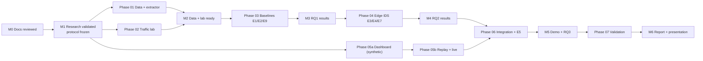

# Implementation Roadmap

Milestone-based; **no calendar dates are invented**. The team sets the dates at M0 according to the course schedule.

| Milestone | Acceptance criteria | Phase guide | Gate owner |
|---|---|---|---|
| M0 | All six students have read the blueprint; open questions Q-01–Q-07 answered or assigned | — | S6 |
| **M1** | 18 full-text reviews done; gap and RQs approved; Δ fixed; EVALUATION_PROTOCOL frozen; repository under Git | [PHASE_00](implementation/PHASE_00_RESEARCH.md) | S1 |
| M2 | Datasets checksummed; data-quality reports reviewed; extractor tests and the parity test pass; lab acceptance run archived | [PHASE_01](implementation/PHASE_01_DATA.md), [PHASE_02](implementation/PHASE_02_TRAFFIC_LAB.md) | S2 + S4 |
| M3 | E1-a, E1, E2, E9 completed or deferred with reasons; CIs reported; one configuration reproduced by a second student | [PHASE_03](implementation/PHASE_03_BASELINES.md) | S3 |
| M4 | Gateway service stable for 1 h; E3, E4, E7 completed; deployed model chosen via E6 | [PHASE_04](implementation/PHASE_04_EDGE_IDS.md) | S4 |
| M5 | Dashboard live and replay working; E5 completed; 3 clean rehearsals; demo archive recorded | [PHASE_05](implementation/PHASE_05_DASHBOARD.md), [PHASE_06](implementation/PHASE_06_INTEGRATION.md) | S5 + S6 |
| M6 | Claim audit clean; reproducibility check done; report and slides delivered | [PHASE_07](implementation/PHASE_07_FINAL_VALIDATION.md) | S6 |

**Critical path:** M1 → Phase 01 (D-01 can force a change of primary dataset) → Phase 03 → Phase 04 → Phase 06.
**Parallel work:** Phase 02 (lab) and Phase 05a (dashboard on synthetic events) can start as soon as M1 is reached.
