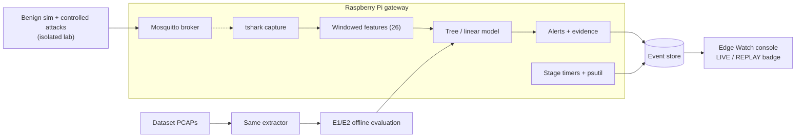

# Master Project Blueprint

**This is the authoritative overview.** It links to the detailed documents and does not repeat them. If this file and a detailed document disagree, raise it in [DECISIONS.md](DECISIONS.md). The detailed document wins until the disagreement is resolved.

**Status (2026-10-20):** Research and design baseline v0.1. **No implementation has started.** The next gate is milestone **M1** (research validated, protocol frozen).

## 1. One-paragraph summary

MQTT brokers are the hub of many IoT systems, and published MQTT intrusion detectors report about 99% accuracy. Those numbers come from within-dataset random splits and from model-only latency on unspecified hardware ([gap analysis](research/RESEARCH_GAP_ANALYSIS.md)). We will:
- (RQ1) measure how detection quality changes under leakage-controlled and cross-dataset evaluation;
- (RQ2) measure the end-to-end, stage-wise cost of a complete capture-to-alert pipeline on a Raspberry Pi gateway;
- (RQ3) measure false alarms on independent benign MQTT traffic in an isolated lab.

A command-center console (*Edge Watch*) presents the live system and the measured results. Every element is traceable to data, and provenance is always shown.

**Recommended title:** *How Lightweight Is Lightweight? End-to-End, Leakage-Controlled Evaluation of MQTT Intrusion Detection on an Edge Gateway.*

## 2. Map of the documentation

| Question | Document |
|---|---|
| Why this project, scope, success criteria | [PROJECT_CHARTER.md](PROJECT_CHARTER.md) |
| What does the literature say? | [research/LITERATURE_REVIEW.md](research/LITERATURE_REVIEW.md), [PAPER_MATRIX.csv](research/PAPER_MATRIX.csv), [REFERENCES.md](research/REFERENCES.md) |
| How was the literature found? | [research/SEARCH_PROTOCOL.md](research/SEARCH_PROTOCOL.md) |
| What is the gap, RQ, hypotheses? | [research/RESEARCH_GAP_ANALYSIS.md](research/RESEARCH_GAP_ANALYSIS.md) |
| What are we building? | [architecture/SYSTEM_ARCHITECTURE.md](architecture/SYSTEM_ARCHITECTURE.md), [DATA_FLOW.md](architecture/DATA_FLOW.md), [ARCHITECTURE_DECISIONS.md](architecture/ARCHITECTURE_DECISIONS.md) |
| What attacks, and what can / cannot be seen? | [architecture/THREAT_MODEL.md](architecture/THREAT_MODEL.md) |
| Which features? | [architecture/FEATURE_SPECIFICATION.md](architecture/FEATURE_SPECIFICATION.md) |
| Which data? | [data/DATASET_SELECTION.md](data/DATASET_SELECTION.md), [DATA_DICTIONARY.md](data/DATA_DICTIONARY.md), [DATA_QUALITY_PROTOCOL.md](data/DATA_QUALITY_PROTOCOL.md) |
| Which models, how trained and scored? | [ml/MODEL_SELECTION.md](ml/MODEL_SELECTION.md), [TRAINING_PIPELINE.md](ml/TRAINING_PIPELINE.md), [MODEL_EVALUATION.md](ml/MODEL_EVALUATION.md) |
| How will we test the hypotheses? | [experiments/EVALUATION_PROTOCOL.md](experiments/EVALUATION_PROTOCOL.md), [EXPERIMENT_TRACKER.md](experiments/EXPERIMENT_TRACKER.md) |
| What does the demo look like and why? | [presentation/VISUAL_CONCEPT.md](presentation/VISUAL_CONCEPT.md), [DASHBOARD_SPECIFICATION.md](presentation/DASHBOARD_SPECIFICATION.md), [VISUALIZATION_RESEARCH_MAPPING.md](presentation/VISUALIZATION_RESEARCH_MAPPING.md) |
| How do we run the demo and talk? | [presentation/DEMO_STORYBOARD.md](presentation/DEMO_STORYBOARD.md), [PRESENTATION_PLAN.md](presentation/PRESENTATION_PLAN.md) |
| What do we do, in which order? | [IMPLEMENTATION_ROADMAP.md](IMPLEMENTATION_ROADMAP.md), [implementation/](implementation/) phase guides |
| Who does what? | [TEAM_WORK_ALLOCATION.md](TEAM_WORK_ALLOCATION.md) |
| What could go wrong? | [RISKS_AND_MITIGATIONS.md](RISKS_AND_MITIGATIONS.md) |
| How do we test, and when is something done? | [TESTING_STRATEGY.md](TESTING_STRATEGY.md), [DEFINITION_OF_DONE.md](DEFINITION_OF_DONE.md) |
| What has been decided / is still open? | [DECISIONS.md](DECISIONS.md) |
| How will results be reported? | [reports/RESULTS_TEMPLATE.md](reports/RESULTS_TEMPLATE.md), [LIMITATIONS.md](reports/LIMITATIONS.md), [FINAL_REPORT_OUTLINE.md](reports/FINAL_REPORT_OUTLINE.md) |

## 3. Canonical names (use these everywhere)

| Concept | Canonical name |
|---|---|
| Research questions | RQ1 (leakage-controlled and cross-dataset quality), RQ2 (end-to-end edge cost), RQ3 (benign-lab FPR), RQ4 (alert-evidence cost, secondary) |
| Hypotheses | H1, H2, H3 |
| Experiments | E1–E9, E1-a, PILOT-E3, DQ-<dataset> |
| Splits | S-rand, S-time, S-episode, S-cross |
| Attack families | T1 CONNECT flood, T2 PUBLISH flood, T3 low-rate DoS, T4 malformed, T5 brute force, T6 wildcard subscribe (rule only), T7 scans |
| Harmonised labels | `benign`, `flood`, `malformed`, `bruteforce`, `lowrate` |
| Components | C1–C14 |
| Dashboard panels | P1–P8 (not to be confused with paper IDs: papers are written `P01`–`P36` with two digits) |
| Provenance | `live`, `replay`, `synthetic` |
| Milestones | M0–M6 |
| Students / workstreams | S1–S6 |
| Product name | Edge Watch |

## 4. Architecture in one picture

## 5. Key decisions (summary; details in ADRs)

| Decision | Choice | Ref |
|---|---|---|
| Contribution type | Evaluation and systems measurement, not a new model | ADR-01 |
| Detection placement | Passive, broker-adjacent, no mitigation | ADR-02 |
| Features | Own extractor from PCAP, shared offline/live, 26 compact features | ADR-03, ADR-04 |
| Models | LR, DT, RF, HistGB (+ Isolation Forest for E2) | ADR-05 |
| Hardware | Raspberry Pi 4/5 gateway; laptop for dev | ADR-06 |
| Datasets | MQTTset (primary), MQTT-IoT-IDS2020, CICIoMT2024 (cross); CICIoT2023 rejected | DATASET_SELECTION |
| Protocol | Plaintext MQTT 3.1.1 primary; TLS as limitation study | ADR-08 |
| Honesty | Server-set provenance on every event | ADR-09 |

## 6. Milestones (details in the roadmap)

M0 docs reviewed → **M1 research validated & protocol frozen** → M2 data + lab ready → M3 offline results (RQ1) → M4 gateway results (RQ2) → M5 integrated demo + RQ3 → M6 final report and presentation.

## 7. Confidence in the current baseline

| Item | Confidence | Why |
|---|---|---|
| The datasets listed contain (or, for CICIoT2023, lack) MQTT attacks | **High** | Official pages / full texts read |
| P19 uses a random stratified split and model-only latency | **High** for the thesis version; **medium** for the journal version | Thesis read; journal version not yet read |
| The end-to-end + leakage-controlled gap is open | **Medium** | 18 papers not yet read in full; IEEE/ACM not searched directly |
| The architecture is feasible on an RPi 4 | **Medium–high** | Similar workloads are reported (P24, P27). Ours includes tshark, which still has to be measured |
| H1–H3 will be confirmed | **Unknown** | That is what the experiments are for |
