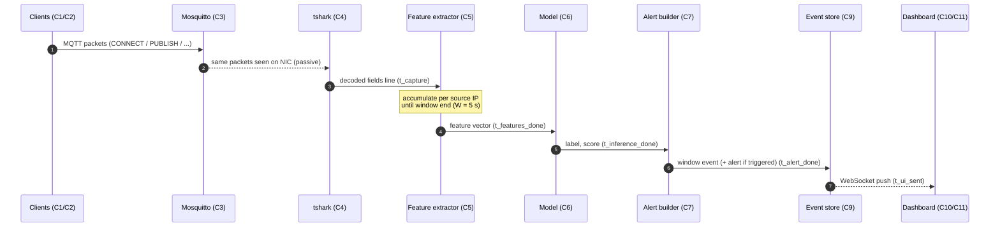
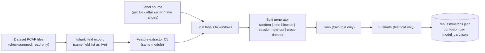

# Data Flow and Event Contract

Components `C1`–`C14` are defined in [SYSTEM_ARCHITECTURE.md](SYSTEM_ARCHITECTURE.md#3-components).

## 1. Live pipeline (one window)

Timestamps `t_*` are taken with `time.perf_counter_ns()` inside the gateway process and stored per window. They give the per-stage latencies for RQ2:

| Stage latency | Definition |
|---|---|
| `capture_to_parse` | tshark decode time per packet. Measured by comparing `frame.time_epoch` with the time the Python process receives the line |
| `window_close_to_features` | Time from window end to the finished feature vector |
| `inference` | `t_inference_done − t_features_done` |
| `alert_build` | `t_alert_done − t_inference_done` |
| `processing_total` | `t_alert_done − window_end`. This is the IDS overhead beyond the unavoidable window wait |
| `end_to_end` | `t_alert_done − first packet in window`. This is what an operator experiences |

## 2. Offline pipeline

Labelling rules and leakage controls: [DATA_QUALITY_PROTOCOL.md](../data/DATA_QUALITY_PROTOCOL.md) and [EVALUATION_PROTOCOL.md](../experiments/EVALUATION_PROTOCOL.md).

## 3. Event contract

The same contract is used for live, replay, and synthetic events (ADR-09). Every event is a JSON object, stored one per line in JSONL and mirrored to SQLite.

### 3.1 Common envelope (all events)

| Field | Type | Required | Meaning |
|---|---|---|---|
| `event_id` | string (UUID) | yes | Unique id |
| `event_type` | enum `window`, `alert`, `resource`, `topology`, `run_marker` | yes | Kind of event |
| `ts` | float (epoch s, gateway clock) | yes | When the event was produced |
| `run_id` | string | yes | Experiment run, linked to the run manifest |
| `provenance` | enum `live`, `replay`, `synthetic` | yes | **Set by the server. Shown on screen at all times** |
| `traffic_source` | enum `benign_sim`, `attack_sim`, `mixed`, `dataset:<name>` | yes | Where the traffic came from |
| `schema_version` | string | yes | Starts at `1.0` |

### 3.2 `window` event

| Field | Type | Notes |
|---|---|---|
| `window_start`, `window_end` | float | Window bounds |
| `source_key` | string | Pseudonymised source (e.g., `dev-07`). The lab IP mapping is kept on the gateway only |
| `features` | object `{F01: number, …}` | See [FEATURE_SPECIFICATION.md](FEATURE_SPECIFICATION.md) |
| `prediction` | enum `benign`, `attack` (binary), or a class name (multi-class) | Model output |
| `score` | float 0–1 or null | Model score. Labelled "score", **not** "confidence", unless calibration was verified (E1 reliability diagram) |
| `model_id` | string | Points to a model card |
| `ground_truth` | string or null | Only from the experiment runner's attack schedule; null otherwise |
| `stage_latency_ms` | object | Keys as in §1 |

### 3.3 `alert` event

| Field | Type | Notes |
|---|---|---|
| `alert_id` | string | |
| `window_ids` | list | Windows that triggered it (k consecutive) |
| `source_key` | string | |
| `predicted_class` | string | |
| `severity` | enum `low`, `medium`, `high` | Rule-based: class × persistence (defined in [MODEL_EVALUATION.md](../ml/MODEL_EVALUATION.md#5-alert-policy)) |
| `evidence` | list of `{feature, value, baseline_p50, contribution}` | Top-k (k = 5). `baseline_p50` is the median over benign training windows |
| `status` | enum `unverified_prediction`, `matches_scheduled_attack`, `no_scheduled_attack` | Computed against `ground_truth`. **Never "confirmed attack"** |

### 3.4 `resource` event (1 Hz)

`cpu_percent_ids`, `cpu_percent_broker`, `rss_mb_ids`, `rss_mb_broker`, `pkts_per_s`, `mqtt_msgs_per_s`, `capture_drops_total`, `soc_temp_c` (RPi only).

### 3.5 `topology` event

`nodes: [{id, kind: device|broker|gateway|attacker_sim, label, state}]` and `edges: [{from, to, msgs_per_s}]`. Nodes are derived from observed sources. The attacker node is shown with the label `attack_sim` **only** when `traffic_source` says so.

### 3.6 `run_marker` event

`marker ∈ {run_start, benign_phase_start, attack_scheduled_start, attack_scheduled_end, run_end}`, plus `scenario`. These come from the experiment runner and drive the storyboard timeline.

## 4. Storage and retention

| Data | Location | Retention | In Git? |
|---|---|---|---|
| Raw dataset PCAPs | `data/raw/<dataset>/` (outside Git, checksums in `data/MANIFEST.sha256`) | Permanent, read-only | **No** (size, licences) |
| Lab captures | `data/lab/<run_id>/` | Per study | **No** |
| Feature tables | `data/features/<dataset>/<extractor_version>/` (Parquet or CSV) | Regenerable | No |
| Results | `results/<exp_id>/` | Permanent | Yes (small JSON/CSV only) |
| Event logs for replay | `results/<run_id>/events.jsonl` | Permanent for demo runs | Yes, if < 10 MB |
| Credentials | `.env` (gitignored) | — | **Never** |
