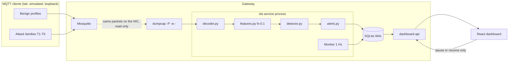

# Final System Architecture

What was built, as opposed to what the earlier design documents propose. Where they differ, the differences are listed in section 5.

## 1. Independence

The three processes share no lifetime. **Tested** by `tests/test_integration_live.py` and `lab/e2e.py` on Windows loopback.

| Event | Broker | IDS | API and page |
|---|---|---|---|
| IDS paused through the API | Keeps acknowledging QoS 1 | Stops capture, stays up | Shows paused |
| IDS hard-killed | Unaffected | dumpcap dies with it (Windows job object) | Store stays readable |
| IDS restarted, model missing | Unaffected | Runs without inference; reports it | Shows "inference off" |
| API killed and restarted | Unaffected | Keeps writing | Banner, then reconnects with no reload. A dashboard-started lab run dies with the API (job object) |
| Model raises on a window | Unaffected | Counts it, keeps monitoring | Error count in P7 |
| Store write fails | Unaffected | Counts it, keeps monitoring | Error count in P7 |

The IDS has no socket, never connects to the broker, and has no network write path. A test checks the source for this. Only a control row exists: there is no blocking or mitigation code.

## 2. Modules

| Path | Role |
|---|---|
| `src/ids/decoder.py` | pcap and pcapng reading, IPv4, IPv6 with extension headers, bounded IP reassembly, TCP streams, MQTT 3.1.1 and the MQTT 5 framing that features need |
| `src/ids/features.py` | The one extractor, F01-F26, `fx-0.1`, unchanged; optional F22 hard limit (`max_open_connections`, exact below it) |
| `src/ids/fields.py` | tshark adapter, kept as the offline reference; `t3_3_lockstep.py` compares against it |
| `src/ids/pipeline.py` | Offline tables, row schema validation, source pseudonyms, diagnostics |
| `src/ids/training.py` | Splits, models, leakage checks, bundles. Engineering evaluation |
| `src/ids/detector.py` | Loads a bundle; refuses extractor, scikit-learn, or feature mismatch; evidence |
| `src/ids/alerts.py` | τ, k = 2, 60 s suppression, severity, F24 rule, ground-truth status; `prune()` forgets idle sources exactly |
| `src/ids/baselines.py` | Rule and rate baselines, thresholds from dev benign windows (numpy only) |
| `src/ids/store.py` | SQLite events and alerts, server-set provenance, retention |
| `src/ids/service.py` | Live and replay runner, capture supervision, resource monitor; bounded per-source state; reads the runner's ground truth and device profiles |
| `dashboard/api/` | FastAPI: health, alerts (search), runs, windows, traffic, resources, markers, topology, model, results, control, simulation, replay comparison; WebSocket `/ws/events`. Host-header allow-list, WebSocket Origin check |
| `dashboard/api/simulation.py` | Starts and stops one bounded `lab.run` at a time on the IDS's port; loopback clients only; argument list, no shell; process tree tied to the API and killed on stop; watchdog |
| `dashboard/web/` | React and TypeScript; tabs Live (overview, P1-P7, P9 analytics), Simulate, Investigate, Compare, Research (P8); no chart library |
| `lab/` | Stdlib MQTT client, benign profiles (incl. smart-home devices), attacks T1-T7, safety limits, runner, `perf.py`, `bench.py`, `e2e.py`, `e2e_cc.py` |
| `deploy/` | systemd units and broker config. **Not run on hardware** |

## 3. Privacy boundaries

| Data | Handling |
|---|---|
| Payloads, client IDs, usernames, passwords | Not decoded by the decoder; have no field in `MqttMessage` |
| Topics | HMAC-SHA256 with a run-scoped key, counted only (T3.1) |
| Source addresses | Grouping key inside the IDS. Replaced by run-scoped HMAC pseudonyms before any event is stored |
| Ground-truth schedule and `devices.json` | Hold lab addresses, which are pseudonymized before reaching the store |
| Raw captures, tables, models, broker credentials | Outside Git and OneDrive, under `edgewatch-data` |

**Tested:** a scan of the store after a full run finds no lab password, username, topic prefix, client ID, or lab address (`results/ENG-E2E/`).

## 4. Event flow and honesty

- Provenance is set when the store is created: `replay` when replaying, `live` otherwise. A replay cannot report `live`.
- The UI resets on a new `run_start`, ignores other runs' events, and shows a red error bar if provenance is mixed or missing.
- States are **normal**, **suspicious** (one window at or above τ), and **alert** (k consecutive windows). A prediction is never called confirmed. Status chips compare with the runner's schedule only when one exists.

## 5. Differences from the design documents

| Design | Built | Why | Status |
|---|---|---|---|
| tshark for live capture (ADR) | dumpcap plus `decoder.py` | tshark memory is unbounded (T3.2: 6.8 GB on `capture_1w`) | **Needs your approval as a replacement.** Lockstep shows 0 differences on 12 M events; tshark stays the offline reference |
| Vite + TypeScript, Cytoscape.js, uPlot (ADR-10) | React + TypeScript, no chart library | Your brief asked for React; SVG covers the panels with fewer dependencies | ADR-10 amendment proposed |
| SQLite + JSONL | SQLite only | One store with WAL is enough; no reader needs JSONL | Proposed |
| Deployed model trained on undefined data (F-10) | Trained on lab runs, labelled engineering | Lab data has episodes and independent rates; MQTTset does not transfer | **Not an RQ1 result** |
| "Replay service" as a separate script | `ids.service --replay` | Same code path as live, which also satisfies the parity rule | Done |
| Synthetic layout generator | Not built | Replaying real captures shows the same panels honestly | Skipped |
| Capture drops per second in P7 | Not shown live | dumpcap only reports them at exit, so TCP gaps and generator-side loss are used | Limitation |
