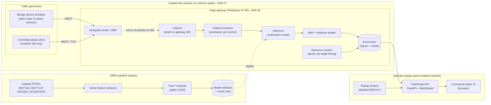

# System Architecture

**Status:** Proposed (for team review at M1). Decisions are recorded in [ARCHITECTURE_DECISIONS.md](ARCHITECTURE_DECISIONS.md) (`ADR-xx`). The research questions it serves are RQ1–RQ4 in [RESEARCH_GAP_ANALYSIS.md](../research/RESEARCH_GAP_ANALYSIS.md#5-research-questions-objectives-hypotheses).

## 1. Purpose

The system has two jobs, and they share one feature extractor:
1. **Offline evaluation pipeline**, which answers RQ1. It takes dataset PCAPs, extracts features, trains models, and evaluates them under several split strategies.
2. **Live edge pipeline**, which answers RQ2–RQ4 and drives the demo. In the isolated lab it runs: MQTT traffic → capture on the gateway → features → inference → alert → event store → dashboard.

Sharing the extractor (ADR-03) is what lets a model trained offline be measured honestly when it runs live.

## 2. Architecture overview

### Planes

| Plane | Contents | Notes |
|---|---|---|
| **Data plane (MQTT application)** | CONNECT/PUBLISH/SUBSCRIBE between clients and broker | This is the traffic being protected. The IDS never modifies it |
| **Observation plane** | Passive packet capture, features, inference, alerts | Read-only with respect to the data plane (ADR-02) |
| **Control/ops plane** | Experiment runner, model deployment, dashboard, replay | Runs on the operator laptop. It never sends traffic to MQTT clients |

### Key distinctions

| Distinction | How the architecture keeps them apart |
|---|---|
| MQTT application messages vs. network packets | The extractor works on **packets** (TCP + MQTT headers decoded by tshark). It never subscribes to topics or reads payload content. Payload length is used; payload bytes are not |
| Collection vs. inference | `CAP` writes ring-buffer PCAP files and streams decoded fields. `FX`/`INF` consume the stream. Stage timings are recorded separately (RQ2) |
| Detection vs. mitigation | There is **no mitigation component**. Alerts are records. Blocking is out of scope (ADR-02, [THREAT_MODEL.md](THREAT_MODEL.md#6-out-of-scope)) |
| Real vs. simulated data | Every event carries `provenance ∈ {live, replay, synthetic}` and `traffic_source ∈ {benign_sim, attack_sim, dataset:<name>}` ([DATA_FLOW.md](DATA_FLOW.md#3-event-contract)). The UI renders provenance at all times |
| Prediction vs. ground truth | Live events carry `ground_truth` only when the experiment runner knows it (scheduled attack windows). Otherwise it is `null`, and the UI shows "unverified prediction" |

## 3. Components

| # | Component | Purpose | Inputs | Outputs | Implementation options (recommended **first**) | Dependencies | Failure modes |
|---|---|---|---|---|---|---|---|
| C1 | Benign device simulator | Realistic, configurable benign MQTT load for RQ3 and the demo | Scenario YAML (devices, topics, rates, QoS, retain, reconnect behaviour) | MQTT traffic | **Python + paho-mqtt** script; IoT-Flock (used by P08) | Broker reachable | Clock drift between hosts; too-regular timing (unrealistic). Mitigate with jitter and recorded seeds |
| C2 | Controlled attack client | Reproduce dataset attack classes against the **local** broker only | Attack scenario (type, rate, duration, start time) | Attack traffic + **ground-truth schedule file** | **Scripted paho-mqtt/raw-socket clients** for connect flood, publish flood, brute force, low-rate keep-alive hold, malformed CONNECT; dataset tools (MQTT-malaria, MQTTSA, MQTT-PWN) only after S4 review | Isolated network; hard-coded target allow-list | Run against the wrong host. Prevented by allow-list + no uplink (ADR-07) |
| C3 | MQTT broker | System under protection | Client connections | Broker behaviour, logs | **Eclipse Mosquitto 2.x** (P36), as used by P08 and P21 | Gateway OS | Broker crash under flood. That is a *result*: record it, restart via runbook |
| C4 | Capture | Observe packets passively | Gateway NIC (or `lo` when broker and capture are co-located) | Decoded field stream (stdout) + rotating PCAP | **tshark** `-T fields -l` with BPF `tcp port 1883`; scapy (slower; fallback) | Wireshark/tshark installed; capture privileges | Packet drops at high rate. Measured and reported (RQ2); tshark prints drop counts |
| C5 | Feature extractor | Turn packets into per-source windowed feature vectors ([FEATURE_SPECIFICATION.md](FEATURE_SPECIFICATION.md)) | Field stream (live) or PCAP (offline) | Feature rows `(window_start, source_key, F01…F26)` | **Pure Python + standard library** aggregation; pandas only offline | C4 | Train/serve skew if offline and live code diverge. Prevented by one module, unit tests, and parity test (ADR-03) |
| C6 | Inference | Classify each window | Feature rows, model artefact | `prediction`, `score`, `model_id` | **scikit-learn** (LR, DT, RF, HistGradientBoosting); joblib artefact with pinned version (ADR-05, ADR-11) | C5, model artefact | Version mismatch between training and gateway. Prevented by a version check at load |
| C7 | Alert + evidence builder | Turn positive predictions into alerts with severity and evidence | Prediction + features | Alert event with top-k contributing features (RQ4) | Rule: alert when score ≥ threshold for k consecutive windows; evidence = tree feature contributions or LR coefficients × values | C6 | Alert storms. Mitigated by de-duplication per source per N seconds (configurable, reported) |
| C8 | Resource monitor | Measure the cost of every stage | Process IDs, stage timers | CPU %, RSS, per-stage latency histograms | **psutil** (already installed on the laptop) + `time.perf_counter_ns` in-process | — | Observer effect. Sampling at 1 Hz; overhead measured once and reported |
| C9 | Event store | Single source of truth for the dashboard and analysis | Events from C6–C8 and the experiment runner | SQLite tables + append-only JSONL | **SQLite** (stdlib) | Disk | Disk full on long runs. Rotation policy in the runbook |
| C10 | Dashboard API | Serve live and replayed events to the UI | Event store, replay files | REST + WebSocket stream | **FastAPI + uvicorn** | C9 | Lag under bursts. UI shows stream delay explicitly |
| C11 | Command-center UI | Make the research visible ([DASHBOARD_SPECIFICATION.md](../presentation/DASHBOARD_SPECIFICATION.md)) | WebSocket events, REST metrics | Visuals | **Vite + TypeScript, Cytoscape.js (topology), uPlot (time series)** | C10 | Browser freeze. Render throttling and an event cap |
| C12 | Replay service | Reliable, repeatable demo | Recorded event log from a real lab run | Same event stream, `provenance=replay` | Small Python script reading JSONL with original timing | C9 recordings | Shown as live by mistake. Prevented because provenance is set by the server and cannot be overridden by the UI |
| C13 | Offline pipeline | Answer RQ1 (E1, E2, E6) | Dataset PCAPs | Metrics, confusion matrices, model artefacts, model cards | Python scripts + scikit-learn; experiment config in YAML; seeds recorded | C5 | Leakage. Controlled by [EVALUATION_PROTOCOL.md](../experiments/EVALUATION_PROTOCOL.md) |
| C14 | Experiment runner | Orchestrate lab runs (benign → attack schedule → stop) | Experiment config | Ground-truth schedule, run manifest | Python script calling C1/C2 | C1, C2 | Mis-aligned clocks. Use a single host's clock for schedule and capture (gateway time) |

## 4. Deployment views

| View | Where things run | Use |
|---|---|---|
| **Dev (laptop only)** | Broker, simulator, capture on loopback, and dashboard on one laptop (WSL2/Linux VM or native) | Development and unit tests. **Not used for RQ2 numbers** |
| **Measurement (target)** | Broker + C4–C9 on the Raspberry Pi gateway. C1/C2 on a second machine. C10–C12 on the laptop | All RQ2–RQ3 numbers |
| **Fallback measurement** | Gateway components in a Linux VM/container limited to the RPi's CPU count and RAM | Only if hardware is unavailable. Every result is labelled `emulated-constraint` (ADR-06) |

The deployment options are compared in [ARCHITECTURE_DECISIONS.md](ARCHITECTURE_DECISIONS.md#adr-06-edge-deployment-target).

## 5. Resource budget (target device, to be validated in Phase 04)

| Resource | Budget | Rationale |
|---|---|---|
| CPU (IDS processes, excluding broker) | ≤ 1 core sustained at the nominal benign load | Leaves headroom for the broker. Passban used ~47% CPU on an RPi 3 [U, P24] |
| RAM (RSS of IDS processes) | ≤ 256 MB | Gateway also hosts the broker; RPi 4 4 GB model |
| End-to-end alert latency | ≤ window length + 1 s (p95) | Windowing dominates by design; the processing overhead is what RQ2 measures |
| Model artefact size | ≤ 20 MB | A deployable RF on a microSD card; reported per model |

These are **design targets, not results**. Phase 04 records whether they are met.

## 6. What this architecture deliberately does not include

- Automatic blocking or broker reconfiguration (detection only).
- Payload content inspection, topic-string features, or credential capture (privacy and shortcut risk; see [FEATURE_SPECIFICATION.md](FEATURE_SPECIFICATION.md#4-excluded-fields)).
- Cloud components. The research question is about the edge.
- Physical sensors. Simulated clients are enough for traffic generation; physical hardware is used only where it is the object of measurement (the gateway).
