# Training Pipeline

## 1. Steps

```mermaid
flowchart LR
  A[Raw PCAP<br/>checksummed] --> B[tshark field export]
  B --> C[Feature extractor fx-x.y]
  C --> D[Label join + DATA_QUALITY checks]
  D --> E[Split generator<br/>random / time-blocked / episode-held-out / cross-dataset]
  E --> F[Fit preprocessing on TRAIN only<br/>scaler for LR; class weights]
  F --> G[Hyperparameter grid on VAL]
  G --> H[Refit on TRAIN+VAL with chosen params]
  H --> I[Threshold on VAL]
  I --> J[Single evaluation on TEST]
  J --> K[metrics.json + model_card.json + joblib]
```



## 2. Rules

1. Preprocessing (scaling, imputation, class weights) is fitted **inside** the training fold. Use a scikit-learn `Pipeline` so it cannot leak.
2. The test fold is touched **once** per `(model, split, seed)`. If someone looks at test results and then changes anything, the change is logged in `EXPERIMENT_TRACKER.md` as a new experiment ID.
3. Seeds: `0–4` for every stochastic step. Results are reported as mean ± std over seeds, plus bootstrap CIs over episodes.
4. One config file per experiment (`configs/<exp_id>.yaml`): dataset(s), split, model grid, seed list, extractor version.
5. Every run writes `git_commit` and environment versions into `metrics.json`.

## 3. Suggested code layout (to be created in Phase 01/03, not now)

```
src/ids/
  fields.py        # tshark field list + runner (shared live/offline)
  features.py      # windowed aggregator (shared live/offline)
  labels.py        # dataset label joins
  splits.py        # split generators
  train.py         # entry point: python -m ids.train configs/E1b.yaml
  evaluate.py
tests/
  test_features.py # hand-crafted PCAP counts + parity test
  test_splits.py   # no episode appears in two folds; time gap respected
configs/
```

## 4. Libraries (pin in `requirements.txt` at Phase 01)

| Library | Purpose | Status on the dev laptop (2026-10-20) |
|---|---|---|
| Python 3.12/3.13 | Runtime | 3.13.7 present (the Anaconda pip points to 3.12; **pick one interpreter** and use a venv) |
| scikit-learn | Models | 1.8.0 present |
| pandas, numpy | Offline tables | 2.3.3 / 2.3.3 present |
| pyarrow | Parquet | Not checked |
| tshark (Wireshark) | Field decoding | **Not installed** (requires approval) |
| psutil | Resource monitoring | 5.9.0 present (Anaconda env) |
| paho-mqtt | Traffic simulation | **Not installed** |
| Mosquitto | Broker | **Not installed** |

Nothing has been installed. Installation happens in Phase 01/02 with team approval ([SETUP_GUIDE.md](../implementation/SETUP_GUIDE.md)).
